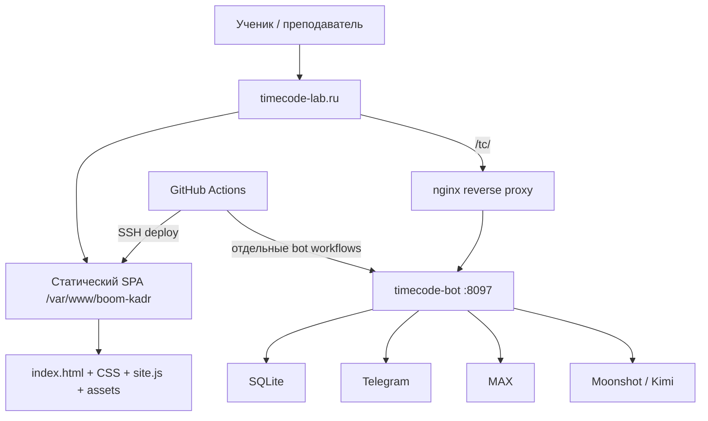

Warning: truncated output (original token count: 28201)
Total output lines: 1181

# TIMECODE — PROJECT AI HANDBOOK

> Эксплуатационный паспорт сайта, контура публикации и связанного TIMECODE-бота.  
> Этот документ нужно прочитать до любых изменений проекта.

| Поле | Значение |
|---|---|
| Проект | TIMECODE — лаборатория креативных медиа |
| Дата аудита | 2026-10-11 09:02 UTC |
| Обследованный checkout | `/workspace/scratch/88cd9ca1586f/timecode-audit` |
| Репозиторий | `https://github.com/mityademon-rgb/news.git` |
| Ветка | `boom-kadr-deploy` |
| Проверенный commit | `1760d97315fd6b7e061dde233a4ab8433b9f1baa` |
| Публичный сайт | `https://timecode-lab.ru/` |
| Production static root | `/var/www/boom-kadr` согласно действующему workflow/nginx-конфигурации |
| Связанный bot root | `/opt/timecode-bot/timecode-bot` |
| Статус | Актуально для указанного commit и фактов production, проверенных 11.10.2026 |

> **Живая память проекта:** текущее устройство хранится в этом handbook, а последовательность всех изменений — в [`PROJECT_CHANGELOG.md`](PROJECT_CHANGELOG.md). Перед работой прочитать оба файла. Корневой `AGENTS.md` делает это обязательным для AI-агентов.

## Статусы достоверности

- **Проверено** — подтверждено исходниками, Git, безопасной локальной проверкой, живым HTTP/UI или успешным read-only production-аудитом.
- **По конфигурации** — следует из файлов репозитория, но сам объект на сервере напрямую не читался в этой сессии.
- **Не проверено** — доступа или безопасного доказательства недостаточно; это нельзя считать фактом.
- **Запрещено в диагностике** — действие меняет production, БД, сервис или отправляет сообщения.

## Оглавление

1. [Краткая карта системы](#1-краткая-карта-системы)
2. [Что работает сейчас](#2-что-работает-сейчас)
3. [Структура репозитория](#3-структура-репозитория)
4. [Frontend и бизнес-логика](#4-frontend-и-бизнес-логика)
5. [Контент и данные сайта](#5-контент-и-данные-сайта)
6. [Стили, шрифты и ресурсы](#6-стили-шрифты-и-ресурсы)
7. [Сборка и источник истины](#7-сборка-и-источник-истины)
8. [Инфраструктура и публикация](#8-инфраструктура-и-публикация)
9. [Связанный бот и Mini App](#9-связанный-бот-и-mini-app)
10. [Git и процесс разработки](#10-git-и-процесс-разработки)
11. [Проверки и диагностика](#11-проверки-и-диагностика)
12. [Практические сценарии](#12-практические-сценарии)
13. [Риски и технический долг](#13-риски-и-технический-долг)
14. [Инструкция для резервного AI-агента](#14-инструкция-для-резервного-ai-агента)
15. [Регламент обновления handbook](#15-регламент-обновления-handbook)
16. [Ограничения аудита](#16-ограничения-аудита)

---

## 1. Краткая карта системы

TIMECODE — русскоязычная образовательная лаборатория креативных медиа для двух программ:

- **KIDS LAB, 12+** — камера, интервью, композиция, видеосюжеты и собственный канал;
- **MEDIA LAB, 14+** — сценарий, журналистика, формат программы, репортаж и социальные медиа.

Основные пользовательские сценарии:

1. Открыть интерактивный урок и пройти его по экранным сценам.
2. Включить полноэкранный режим и подсказки преподавателю.
3. Открыть служебный план урока преподавателя.
4. Играть в четыре коротких медиа-игры.
5. Читать киноистории и библиотеку практических лайфхаков.
6. Смотреть материалы проекта «Ты в теме!» и переходить в VK.
7. Пользоваться связанным Telegram/MAX-ботом и Mini App через `/tc/`.



### Компоненты

| Компонент | Назначение | Реальный источник |
|---|---|---|
| Статический сайт | Уроки, игры, кино, лайфхаки, учительский интерфейс | Репозиторий `news`, ветка `boom-kadr-deploy` |
| Nginx | TLS, статика, редиректы, прокси `/tc/` | `.deploy/boom-kadr-https.conf`; живые заголовки сверены |
| GitHub Actions | Публикация сайта и множество операций с ботом | `.github/workflows/` |
| TIMECODE-бот | Telegram/MAX, расписание, игры, рассылки, Mini App | Production `/opt/timecode-bot/timecode-bot`; отдельная кодовая история |
| SQLite | Пользователи, расписание, состояния, очереди, конкурсы | `/var/lib/timecode-bot/timecode.db` |
| Внешние медиа | VK, источники и площадки просмотра фильмов | URL в `app.js`/`site.js` |

Сайт не использует frontend-фреймворк, Node-сборщик, серверный рендеринг или собственный API. Это один hash-based SPA на HTML, CSS и vanilla JavaScript. Backend существует только в отдельном контуре `/tc/`.

---

## 2. Что работает сейчас

### Проверено на живом сайте 11.10.2026

- `https://timecode-lab.ru/` возвращает HTTP 200.
- `https://timecode-lab.ru/tc/health` возвращает HTTP 200 и JSON health-ответ.
- Live-файлы `index.html`, `styles.css`, `lesson03-kids.css`, `site.js` побайтно совпали с проверенным checkout по SHA-256.
- Визуально загружена актуальная 3D-шапка TIMECODE с камерой и микрофоном.
- Проверены маршруты home, PLAY, игра «Разговори человека», кино, история «Матрица», «Ты в теме!», библиотека лайфхаков, урок `interview`, учительский вход.
- На проверенном desktop viewport горизонтального переполнения на этих маршрутах нет.
- Ошибок приложения в консоли не обнаружено; единственная ошибка относилась к служебному browser extension, а не к сайту.

### Функциональная готовность

| Область | Состояние |
|---|---|
| Уроки | 15 записей: 14 готовы, урок 01 KIDS LAB имеет статус `soon` |
| KIDS LAB | 9 записей, из них 8 готовых |
| MEDIA LAB | 6 готовых уроков A01–A06 |
| Сцены уроков | 361 экран |
| Планы преподавателя | 14, по одному для каждого готового урока |
| PLAY | 4 сценария: talk, crew, hack, frame |
| Киноистории | 6 фильмов, по 2 в трёх категориях |
| Лайфхаки | 59 карточек из уроков, 5 фильтров |
| «Ты в теме!» | Отдельная страница, ссылка на VK Видео и сообщество |
| Бот `/tc/` | Служба и HTTP health доступны на момент проверки |

### В разработке или не завершено

- KIDS LAB урок 01 `studio-start` — карточка «Скоро», без сцен и плана преподавателя.
- В production-аудите бот-конкурса Kimi было 16 участников, но ещё не было кадров, голосов, шорт-листа и результата на момент снимка.
- Нет автоматизированного полного e2e/regression-набора сайта.
- Для `site.js` введены детерминированная сборка и проверка соответствия исходникам; публикация этой версии требует отдельной live-проверки.

---

## 3. Структура репозитория

После введения проектной памяти в репозитории 181 tracked-файл, около 18 MB. В корне нет `package.json`, lock-файла, `.gitignore` или `CLAUDE.md`; правила для агентов находятся в `AGENTS.md`.

```text
news/                         # корень репозитория
├── AGENTS.md                 # обязательный порядок работы AI-агентов
├── PROJECT_AI_HANDBOOK.md    # актуальная архитектурная карта
├── PROJECT_CHANGELOG.md      # последовательный журнал всех изменений
├── index.html                # единственная HTML-точка входа
├── styles.css                # глобальные стили и 3D hero
├── lesson03-kids.css         # отдельные overrides урока 03
├── lessons.js                # данные уроков, лайфхаков и переносимых упражнений
├── lesson-plans.js           # актуальные планы преподавателя
├── teacher-guides.js         # устаревший дубликат; не подключён
├── app.js                    # читаемый runtime-исходник, включая 3D hero
├── site.js                   # генерируемый production bundle
├── README.txt                # устаревшая инструкция
├── assets/                   # изображения, бренд и шрифты
│   ├── brand/                # SVG-логотипы и знаки
│   └── fonts/                # TTF и лицензии
├── .deploy/                  # nginx и исторические shell-deploy scripts
├── scripts/                  # сборка site.js, создание записи и локальные проверки
└── .github/workflows/        # 92 workflow, включая documentation guard
```

### Карта значимых файлов

| Путь | Роль | Можно менять | Особое правило |
|---|---|---|---|
| `index.html` | Каркас, header/footer, CSS/JS подключения | Да, с проверкой всех маршрутов | При изменении bundle/CSS обновлять cache-busting query |
| `styles.css` | Основной визуальный слой | Да | 7 186 строк и много исторических media-query; проверять каскад |
| `lesson03-kids.css` | Изолированные стили конкретного урока | Только если затронут этот урок | Не переносить вслепую в общий CSS |
| `lessons.js` | Контент и сцены уроков | Да | После правки выполнить `scripts/build-site.sh` |
| `lesson-plans.js` | Актуальные учительские планы | Да | Должны соответствовать ready-урокам |
| `teacher-guides.js` | Старый набор планов | Не использовать как source of truth | Не подключён и не публикуется текущим workflow |
| `app.js` | Основная SPA-логика | Да | Содержит подтверждённые 3D-изменения hero |
| `site.js` | Файл, реально выполняемый браузером | Генерируется | Не редактировать вручную; собирать `scripts/build-site.sh` |
| `scripts/build-site.sh` | Детерминированная сборка и consistency-check | Да, с проверкой workflow | Порядок: `lessons.js` + `lesson-plans.js` + `app.js` |
| `assets/` | Изображения, SVG, шрифты | Да | Сверять пути, размер и лицензию |
| `.deploy/boom-kadr-https.conf` | Текущая проектная схема nginx | Только с отдельной инфраструктурной проверкой | Сохранять `/tc/` proxy |
| `.deploy/install.sh`, `update.sh`, `https.sh` | Старый pull-based deploy | Не запускать | Содержат старый IP и неполный набор файлов |
| `.github/workflows/deploy-boom-kadr.yml` | Текущий static deploy | Только после review | Проверяет bundle; rollback статических файлов всё ещё неполный |
| `PROJECT_CHANGELOG.md` | Хронология каждого изменения | Обновлять в каждом commit | Не содержит секретов; newest-first после маркера |
| `AGENTS.md` | Обязательные правила следующему AI | Менять вместе с handbook/changelog | Действует на весь репозиторий |
| `scripts/check-project-documentation.sh` | Локальный и CI guard | Да, с self-test | Требует changelog всегда и handbook для structural paths |
| остальные workflows | Bot deploy/диагностика/разовые операции | Не запускать для исследования | Многие рестартуют сервис, пишут БД или шлют сообщения |

### Исходники, сборка и serving directory

- **Исходники в Git:** перечисленные файлы корня.
- **Фактическая browser-сборка:** `site.js`.
- **Serving directory по workflow:** `/var/www/boom-kadr`.
- **Deployment archive:** создаётся в GitHub Actions и распаковывается поверх существующей serving directory.
- Production static root не объявлен Git checkout; workflow копирует архив, поэтому `git status` там не является ожидаемой диагностикой.
- Workflow не очищает удалённые из Git файлы на сервере: stale-файлы могут оставаться.

---

## 4. Frontend и бизнес-логика

### Стек

- HTML5, CSS3, vanilla JavaScript.
- Hash router в `route()` около конца `app.js`/`site.js`.
- Полное client-side rendering через `main.innerHTML`.
- Состояние урока и доступ преподавателя — `localStorage`.
- Fullscreen API с CSS fallback `presentation-mode`.
- Web Audio API создаёт короткий звук кнопки; аудиофайла нет.
- Сетевых `fetch`, XHR, WebSocket или EventSource в сайте нет.

### Маршруты

| Route | Renderer | Назначение |
|---|---|---|
| `#/` | `renderHome()` | Главная, 3D hero, превью разделов |
| `#/lesson/:id` | `renderLesson()` | Урок по сценам |
| `#/teacher` | `renderTeacherPortal()` | Список планов/форма доступа |
| `#/teacher/:id` | `renderTeacherPortal(id)` | Конкретный план |
| `#/play` | `renderPlayHub()` | Хаб игр |
| `#/play/talk` | `renderTalkGame()` | Игра интервью |
| `#/play/crew` | `renderCrewTest()` | Тест роли в производстве |
| `#/play/hack` | `renderDailyHack()` | Лайфхак дня |
| `#/play/frame` | `renderFrameGame()` | Игра на ошибки кадра |
| `#/cinema` | `renderCinemaHub()` | Каталог фильмов |
| `#/cinema/:id` | `renderCinemaStory(id)` | История фильма |
| `#/you-in-topic` | `renderYouInTopic()` | Страница шоу |
| `#/lifehacks` | `renderLifehackLibrary()` | Все лайфхаки и фильтры |
| `#lessons`, `#lifehacks`, `#about` | `renderHome(anchor)` | Legacy-якоря главной |

Неизвестный route возвращает пользователя на главную. Сервер для любого несуществующего пути отдаёт `index.html`, но приложение ожидает именно hash route.

### Важные функции и зависимости

| Что делает | Где | Откуда вызывается | Безопасное изменение и проверка |
|---|---|---|---|
| Маршрутизация | `route()` | `hashchange`, старт IIFE | Добавить route, renderer, nav-link; проверить прямой URL и переходы между разделами |
| Главная/3D hero | `renderHome()`, `bindTitleInteractions()` | `route()` | Сверить `app.js` и `site.js`; pointer, reduced-motion, desktop/mobile |
| Урок | `renderLesson()`, `drawScene()`, `sceneTemplate()` | `#/lesson/:id` | Проверить все типы сцен, стрелки, F, Escape, сохранение прогресса |
| Прогресс | `changeScene()` | Кнопки/клавиши | Ключ `timecode:<lesson-id>:scene`; проверить старый fallback `boom-kadr:*` |
| Teacher mode | `toggleTeacherMode()` | Кнопка урока | Проверить подсказки во всех типах сцен |
| Fullscreen | `toggleFullscreen()` | Кнопка/F | Проверить API и CSS fallback на мобильном браузере |
| Планы | `renderTeacherPortal()` | Teacher routes | План существует только при ready-уроке и записи в `lesson-plans.js` |
| Лайфхаки | `renderLifehackLibrary()` | `#/lifehacks` | Данные берутся из всех `lesson.lifehacks`; проверить фильтры и count |
| Кино | `cinemaCatalog`, renderers | cinema routes | Проверить источник, watch URL, `target=_blank` и `rel=noopener noreferrer` |
| PLAY | каталоги/состояние `state` | play routes | Проверить restart/next/result для каждой игры |

### Состояние и авторизация

- Прогресс урока хранится только в браузере; серверного профиля и синхронизации нет.
- Teacher portal использует client-side hard-coded gate и флаг `timecode:teacher-access=granted`.
- Это **не настоящая авторизация**: проверка и секрет находятся в публичном JS, а флаг можно установить вручную.
- Нельзя хранить в teacher plans персональные, закрытые или чувствительные сведения.
- Фактические значения client-side credential намеренно не повторяются в handbook.

### Обработка ошибок

- Для неизвестного урока/игры/фильма — возврат к соответствующему hub/home.
- Fullscreen имеет try/fallback, но общесайтового error boundary нет.
- Ошибка загрузки `site.js` оставит пустой `<main>`.
- Нет централизованного логирования, telemetry или мониторинга frontend.

### Найденное поведение SPA

При последовательной навигации между разделами классы `cinema-active`, `topic-active`, `home-active`, `lesson-active`, `teacher-portal-active` удаляются несимметрично и могут накапливаться на `<body>`. В проверенном проходе route продолжали отображаться, но это технический долг и риск CSS-конфликтов. Исправление должно сопровождаться матрицей переходов между всеми разделами.

---

## 5. Контент и данные сайта

### Уроки

`lessons.js` экспортирует `window.TIMECODE_LESSONS`. Каждая запись обычно содержит id, номер, track/status, заголовок, summary, color, tags, cover, сцены и lifehacks.

- 15 уроков.
- 14 ready, 1 soon.
- 361 сцена; новые уроки школы ведущих используют 23 KIDS-экрана и 27 MEDIA-экранов.
- Ready-уроки не имеют пустых сцен; duplicate lesson id не найдено.

Уроки `host-voice-play` и `adult-live-host` содержат отдельный массив `exercises` (10 и 8 упражнений) с полями для будущего переноса в бот: идентификатор, возраст, навык, инструкция, ситуация, варианты, правильный ответ или критерии, объяснение, сложность, длительность, подсказки, визуалы и `botReady`. Интерфейс поддерживает специальные layout-механики `host-choice`, `host-order`, `host-drill` и `host-checklist`; карточки `camera-cards` допускают собственные подписи ролей и тайминг. `host-drill` проводит участника по фиксированным шагам с количеством повторов, контрольной фразой и итоговым сравнением первой и последней попытки; он используется в MEDIA A06 для техники речи, адресности, работы двух ведущих, интервью, паузы, импровизации, юмора и ритма. Для MEDIA A06 действует отдельное методическое правило: каждый практический шаг содержит точный звук, фразу, ответ или диалог; речевой блок строится как «причина проблемы → движение речевого аппарата → звуки → слова → смысловые паузы → полный текст». Карандаш объясняется и применяется внутри этой системы только как краткий инструмент сопротивления для артикуляции, а свободная импровизация допускается после выполнения заданного материала.

Основные типы сцен обрабатывает `sceneTemplate()`. При добавлении нового `scene.type` сначала добавить renderer и teacher note, затем контент.

### Учительские планы

`lesson-plans.js` экспортирует `window.TIMECODE_TEACHER_GUIDES`:

- 12 guide-записей;
- покрытие совпадает со всеми 12 ready-уроками;
- `studio-start` ожидаемо не имеет guide;
- структура: аудитория, длительность, результат, подготовка, блоки, checkpoints, avoid.

`teacher-guides.js` содержит старую сокращённую копию, не подключён `index.html`, не включён в deployment archive и не должен редактироваться вместо `lesson-plans.js`.

### Игры и кино

- `playCatalog`: `talk`, `crew`, `hack`, `frame`.
- Crew profiles: director, operator, journalist, editor, producer.
- Interview rounds: 5; crew questions: 6; daily hacks: 6; frame questions: 4.
- `cinemaCatalog`: `ivan-vasilievich`, `diamond-arm`, `matrix`, `jaws`, `morozko`, `buratino`.
- Категории: «Наши», «Зарубежные», «Сказки» — по два фильма.
- В Matrix watch link используется KION, но в списке редакционных источников всё ещё есть Apple TV. Это не runtime-баг, а редакционное решение для согласования владельцем.

### Лайфхаки

- 48 элементов собираются из `lesson.lifehacks`.
- Фильтры: shooting, directing, script, journalism, on-camera.
- Счётчик и карточки вычисляются динамически; не хранить число 48 отдельно в HTML.

---

## 6. Стили, шрифты и ресурсы

### CSS

- `styles.css`: 7 186 строк; общий дизайн, responsive breakpoints, print и `prefers-reduced-motion`.
- `lesson03-kids.css`: 299 строк; overrides отдельного занятия.
- В stylesheet есть несколько исторических слоёв и повторяющиеся media queries. Изменение позднего блока может перекрыть раннее правило с той же специфичностью.
- Перед правкой искать все определения класса через `rg`, а не менять первое совпадение.

### Шрифты

Фактически объявлены через `@font-face`:

- Rubik Mono;
- Oswald TIMECODE.

В `assets/fonts/` также лежат `Onest-Variable.ttf` и `Pangolin-Regular.ttf`, но для них нет действующего `@font-face`. При этом body ссылается на `Onest BK`, поэтому браузер использует fallback system sans. Это несоответствие следует либо осознанно исправить с проверкой лицензии/метрик/CLS, либо убрать неиспользуемые ресурсы отдельной задачей.

### Assets

- Проверено 59 локальных ссылок на ресурсы: отсутствующих файлов не найдено.
- Основной формат изображений — WebP; бренд — SVG; шрифты — TTF.
- Известные неиспользуемые кандидаты: `adult01-fireworks.webp`, `adult01-rain-cake.webp`, старые `boom-kadr` SVG, Onest и Pangolin.
- Не удалять их в рамках другой задачи: сначала подтвердить отсутствие runtime/CSS/workflow ссылок и согласовать визуальную историю.

---

## 7. Сборка и источник истины

### Детерминированная сборка

`site.js` собирается в фиксированном порядке:

```text
lessons.js + lesson-plans.js + app.js
```

Историческое расхождение 3D hero устранено: wrapper `.timecode-word-3d`, `.studio-depth-lines`, pointer handler через `requestAnimationFrame`, координаты света и reset на `pointerleave` перенесены из bundle в `app.js`.

Source of truth:

1. `lessons.js` — данные уроков и лайфхаков.
2. `lesson-plans.js` — планы преподавателя.
3. `app.js` — runtime-логика, маршруты и шаблоны.
4. `site.js` — генерируемый browser bundle; вручную не редактируется.

Команды:

```bash
scripts/build-site.sh
scripts/build-site.sh --check
```

Deploy workflow выполняет `--check` и `node --check` до SSH. Если tracked `site.js` не совпадает с тремя исходниками, публикация останавливается до подключения к серверу.

### Cache busting

`index.html` подключает:

```text
styles.css?v=20261012-exact-host-scripts-3
lesson03-kids.css?v=20260917-2
site.js?v=20261012-speech-system-v2
```

Nginx кэширует CSS/JS/images 7 дней. Любая правка содержимого должна сопровождаться изменением соответствующего `?v=`. Query для `site.js` пока меняется вручную.

---

## 8. Инфраструктура и публикация

### Проверенная схема

- Public domain: `timecode-lab.ru`.
- `www.timecode-lab.ru` и legacy nip.io перенаправляются на canonical host по repository config.
- SSH/deploy endpoint в workflow: `217.149.24.242`.
- HTTPS vhost слушает адрес `217.149.24.234:443`.
- Static root: `/var/www/boom-kadr`.
- `/tc/` proxy: `http://127.0.0.1:8097/` со снятием префикса.
- TLS: Let's Encrypt, протоколы TLS 1.2/1.3 по конфигурации.
- Live server header: nginx 1.28.3 (Ubuntu).
- Security headers: `X-Content-Type-Options: nosniff`, `Referrer-Policy: strict-origin-when-cross-origin`.

Не проверены непосредственно: активный on-host nginx file, certificate expiry/renew timer и системные nginx logs. Конфигурация и живое поведение согласуются, но это не полный root-level audit статического vhost.

### Текущий CI/CD

`.github/workflows/deploy-boom-kadr.yml`:

1. Запускается на push в `boom-kadr-deploy` для сайта, его исходников, bundle, build-script и конфигурации либо вручную.
2. Checkout фиксированной ветки.
3. Проверяет, что `site.js` совпадает с исходниками, и запускает JS syntax checks.
4. Создаёт archive из HTML, CSS, `site.js`, исходных JS, assets и README.
5. Загружает archive и nginx configs по SSH.
6. Распаковывает поверх `/var/www/boom-kadr`.
7. Проверяет nginx config, локальный HTTP, DNS, сертификат и локальный HTTPS.
8. Проверяет public canonical/www/legacy и два соседних сайта.

### Проблемы deployment workflow

- Cache query `site.js?v=` меняется вручную и пока не связан автоматической проверкой с изменением bundle.
- Path trigger не включает `teacher-guides.js`, а archive тоже не включает его; сейчас это соответствует тому, что файл устарел.
- Archive содержит `app.js`, `lessons.js`, `lesson-plans.js`, хотя браузер их не подключает напрямую.
- Распаковка идёт поверх существующих файлов без очистки removed assets.
- Rollback сохраняет только nginx config. Предыдущая версия статических файлов не архивируется.
- Ошибка после распаковки может оставить новые static bytes при возвращённом старом nginx config.
- `certbot --keep-until-expiring` выполняется в каждом deploy и расширяет blast radius обычной контентной публикации.
- Workflow использует root SSH; компрометация action/secret даёт высокий impact.

### Устаревшие deployment scripts

`.deploy/install.sh`, `.deploy/update.sh`, `.deploy/https.sh` относятся к старой BUM.КАДР-схеме и адресу `72.56.65.161`. `update.sh` копирует неполный набор и не поддерживает nested assets/fonts/brand, `site.js`, планы и дополнительный CSS. Их запуск на текущем production запрещён до отдельной миграции/удаления.

### Безопасная публикация сайта

До изменения:

```bash
git fetch origin boom-kadr-deploy
git status --short --branch
git diff --check
```

Локальные read-only проверки:

```bash
node --check lessons.js
node --check lesson-plans.js
node --check app.js
node --check site.js
rg -n 'styles.css\?v=|lesson03-kids.css\?v=|site.js\?v=' index.html
```

После согласованного commit/push дождаться workflow `Deploy TIMECODE safely`, затем:

```bash
curl -fsS https://timecode-lab.ru/ | rg 'TIMECODE'
curl -fsSI 'https://timecode-lab.ru/site.js?<current-version>'
curl -fsS https://timecode-lab.ru/tc/health
```

Нужно также сравнить SHA-256 live-файлов с commit, открыть основные routes, проверить desktop/mobile, pointer/reduced-motion, урок, teacher, fullscreen и console.

### Откат сайта

Текущий workflow не обеспечивает content rollback. Практический вариант:

1. Определить последний известный хороший commit.
2. Создать новый revert commit только затронутых site-файлов; не force-push.
3. Убедиться, что изменён путь, входящий в deploy trigger; лучше вручную запустить workflow после review.
4. Проверить live SHA и маршруты.
5. Если deploy оборвался после распаковки, нужен явный серверный snapshot/backup static root — текущий workflow его не создаёт.

`git reset --hard`, `git clean`, force-push и ручное удаление `/var/www/boom-kadr` не являются допустимым штатным откатом.

---

## 9. Связанный бот и Mini App

### Граница компонентов

Бот не хранится полноценно в этом checkout. Его production root — `/opt/timecode-bot/timecode-bot`; на сервере уже сохранён отдельный подробный `PROJECT_AI_HANDBOOK.md`. Этот документ не заменяет bot handbook: перед изменением `/tc/` нужно прочитать серверный файл.

### Проверенные production-факты 11.10.2026

- Ubuntu 26.04 LTS, Python 3.14.4.
- `timecode-bot.service` active.
- Working directory `/opt/timecode-bot/timecode-bot`.
- HTTP port 8097, public base URL `https://timecode-lab.ru/tc/`.
- SQLite `/var/lib/timecode-bot/timecode.db`, quick_check OK, размер около 2.64 MB.
- DB/env имеют mode 0600.
- Kimi model `kimi-k2.6`; отдельная vision model не задана.
- Telegram работает через polling; MAX — webhook; scheduler выполняется в том же Python-процессе.
- 17 enabled users: 1 admin, 16 members. В handbook и отчётах нет персональных строк.
- Расписание: вторник kids 18:00, media 19:00; суббота kids 12:00, media 13:30; старый media 15:00 disabled.
- Watchdog/health timers active.
- Диск: около 14 GB, использовано 5.7 GB, свободно 7.7 GB на момент аудита.
- Production bot Git HEAD `799d465512286f1316cc5c0cb2d871badc82a359`.

### Архитектура бота

Один Python-процесс обслуживает:

- Mini App HTTP/API;
- Telegram long polling;
- MAX webhook;
- scheduler;
- контент, конкурсы, игровые состояния;
- очереди уведомлений;
- Kimi/Moonshot AI-интеграцию.

SQLite содержит users, lessons/overrides, sent/outbox, check-ins, игры, Kimi contests/votes/results, screenplay/script reviews, identity mapping и другие operational таблицы. Полная обезличенная schema и fingerprints находятся в bot handbook на production.

### Критическая особенность Git бота

Production bot checkout не чистый:

- `server.py` modified;
- статические файлы modified;
- множество новых модулей/resources untracked;
- состояние не воспроизводится простым checkout известного commit.

Нельзя выполнять в `/opt/timecode-bot/timecode-bot`:

```text
git reset --hard
git clean -fd
git pull с возможным overwrite
замену server.py старой копией целиком
```

Сначала сохранить полный inventory/diff/backup, определить фактический source of truth и оформить server-only работу в Git без потери файлов.

### Безопасная диагностика бота

Только read-only и только при разрешённом production-доступе:

```bash
systemctl is-active timecode-bot.service
systemctl show timecode-bot.service -p MainPID -p ActiveState -p ExecMainStartTimestamp
curl -fsS --max-time 5 http://127.0.0.1:8097/health
curl -fsS --max-time 10 https://timecode-lab.ru/tc/health
systemctl list-timers --all
ss -ltn
cd /opt/timecode-bot/timecode-bot
git status --short --branch
```

Для логов:

```bash
journalctl -u timecode-bot.service --since '30 minutes ago' --no-pager
```

Логи могут содержать персональные данные и сообщения: анализировать на сервере, наружу переносить только агрегаты и обезличенные ошибки.

SQLite читать URI `mode=ro`, не импортировать приложение ради schema: некоторые module `install()` меняют БД уже при импорте. Не запускать retry, scheduler tick или watchdog вручную — они способны отправлять реальные сообщения/менять состояние.

### Изменяющие операции

`systemctl restart timecode-bot.service`, database backup/restore, API schedule edit, delivery retry, запуск bot-deploy/broadcast workflows — только после отдельного согласования, backup и плана проверки. Откат кода не отменяет миграции БД и уже отправленные сообщения.

---

## 10. Git и процесс разработки

### Проверенное состояние аудита

- Remote: `origin https://github.com/mityademon-rgb/news.git`.
- Ветка: `boom-kadr-deploy`.
- Local и remote HEAD до создания handbook совпадали: `1760d973...`.
- Свежий audit checkout был clean.
- Отдельный старый checkout `/workspace/scratch/88cd9ca1586f/timecode-site` находится на `2cb83a7` и имеет пользовательские uncommitted font changes. Его нельзя reset/clean и нельзя считать текущим source of truth.
- Последний commit core-сайта: `d514e7e` — industrial condensed display type.
- Последний commit 3D hero: `5b5f7b8` плюс CSS fixes `132451b`, `1ea115c`.

### Workflow inventory

В `.github/workflows/` — 92 YAML после добавления documentation guard:

- все 92 содержат push trigger;
- 15 дополнительно имеют `workflow_dispatch`;
- 87 содержат SSH-контур;
- 51 содержит restart/start/stop service;
- 12 содержат признаки messaging/broadcast;
- 12 содержат SQL write operations.

Это смесь текущего deploy, диагностики и одноразовых production-патчей. Сам факт наличия workflow не означает, что его безопасно повторить. Некоторые workflow запускаются push-ом собственного файла и способны рестартовать бот/отправить сообщения.

### Правила Git

1. Всегда `fetch` и сверить remote head до создания commit.
2. Работать из clean checkout/ветки; не использовать stale `timecode-site`.
3. Не смешивать content/design, infrastructure и bot changes в одном commit.
4. Не force-push production branch.
5. Перед push просмотреть `git diff --stat`, полный diff и `git diff --check`.
6. Для site changes убедиться, что путь входит в deploy trigger; иначе явно запустить reviewed workflow или исправить trigger отдельным commit.
7. Зафиксировать live commit/hashes и результаты проверки после deploy.
8. Не трактовать успешный Git commit как успешную публикацию.

### Устаревшая документация

`README.txt` говорит о `dist/`, которого нет, и утверждает, что изменения в `lessons.js` достаточно загрузить напрямую. Live page загружает `site.js`, поэтому README неполон и опасен как operational guide. Использовать handbook как стартовую карту, затем проверять затронутые факты.

---

## 11. Проверки и диагностика

### Выполнено в аудите

- `node --check`: `lessons.js`, `lesson-plans.js`, `app.js`, `site.js` — пройдено.
- Проверка duplicate lesson id — дублей нет.
- Проверка ready lessons без scenes — отсутствуют.
- Покрытие guides — 14/14 ready lessons.
- Проверка локальных asset references — 59 ссылок, 0 missing.
- Исторический 3D drift подтверждён аудитом и затем устранён переносом изменений в `app.js`; `scripts/build-site.sh --check` подтверждает точное совпадение bundle.
- SHA-256 live/repo для 4 обслуживаемых core-файлов — полное совпадение.
- HTTP root и `/tc/health` — 200.
- UI smoke восьми ключевых routes — отрисовка успешна.
- Desktop horizontal overflow — не обнаружен на проверенных routes.
- Browser console — ошибок сайта не обнаружено.

### Минимальный локальный smoke

```bash
node --check lessons.js
node --check lesson-plans.js
node --check app.js
node --check site.js
scripts/build-site.sh --check
git diff --check
```

Запуск локального static server, если разрешён и нужен визуальный review:

```bash
python3 -m http.server 4173 --bind 127.0.0.1
```

Команда только локальная; не запускать её вместо production service и не открывать наружу.

### Матрица ручной проверки сайта

| Область | Проверить |
|---|---|
| Главная | 3D depth, pointerleave, CTA, hero clipping, nav |
| Mobile | 320/375/430 px, menu, отсутствие overflow, readable hero |
| Reduced motion | Нет обязательной анимации/pointer эффекта |
| Урок | Первый/последний кадр, next/back, reload progress, legacy key |
| Fullscreen | Button, F, Escape, mobile CSS fallback |
| Teacher | Login failure/success без публикации credential, logout, print |
| PLAY | Каждый из 4 flows до результата и повторный запуск |
| Cinema | 6 routes, source/watch links, возврат в каталог |
| Lifehacks | 59 cards, каждый filter, reset/count |
| SPA transitions | Все body classes после переходов в обе стороны |
| Console/network | 404 assets, JS errors, cache version |

### Неавтоматизированные проверки

Фактическая responsive-вёрстка на физических iOS/Android, Safari fullscreen, screen-reader workflow, печать teacher plan, доступность keyboard focus по всем играм и внешние ссылки не прошли исчерпывающий тест. Их нельзя объявлять подтверждёнными.

---

## 12. Практические сценарии

### Сценарий: изменить 3D-шапку или дизайн главной

1. Найти все правила hero в `styles.css` и markup/interaction в `app.js`.
2. Изменить source `app.js`, затем собрать `site.js` через `scripts/build-site.sh`; bundle вручную не править.
3. Не менять исходные изображения без проверки размеров/crop на 320–1440 px.
4. Проверить pointer, pointerleave, keyboard CTA, reduced-motion и no-overflow.
5. Обновить CSS/JS cache version в `index.html`.
6. Выполнить syntax/diff/asset checks, затем deploy и live SHA/UI smoke.

### Сценарий: заменить или подключить шрифт

1. Проверить лицензию в `assets/fonts/*-OFL.txt`.
2. Добавить/изменить `@font-face` с уникальным `font-family`, корректными weight/style/display.
3. Использовать этот family в нужных селекторах; не полагаться на отсутствующий `Onest BK`.
4. Проверить кириллицу, латиницу, цифры, line-height, переносы hero/navigation/mobile.
5. Проверить network 200 и отсутствие CLS/FOIT.
6. Обновить CSS cache version и live verify.

### Сценарий: добавить урок

1. Добавить уникальный объект в `lessons.js` с track/status/scenes/lifehacks.
2. Для ready-урока добавить guide в `lesson-plans.js`.
3. Добавить assets и проверить каждую ссылку.
4. Проверить scene types и escape paths; не вставлять непроверенный HTML в контент.
5. Выполнить `scripts/build-site.sh`, затем `scripts/build-site.sh --check`.
6. Проверить homepage counts, route, progress, teacher plan, fullscreen, mobile.
7. Обновить query `site.js?v=` и публиковать.

### Сценарий: изменить киноисторию/внешнюю ссылку

1. Править `cinemaCatalog` в `app.js`, затем пересобирать `site.js` через `scripts/build-site.sh`.
2. Различать editorial source URL и `watchUrl`.
3. Проверить доступность/региональность ссылки и права; не заявлять непроверенные факты.
4. Сохранить `target="_blank" rel="noopener noreferrer"`.
5. Проверить catalog и detail route.

### Сценарий: добавить новый frontend feature

1. Определить route и renderer рядом с существующими функциями.
2. Очистить/установить body classes симметрично.
3. Любые пользовательские строки проводить через `escapeHtml`.
4. Не создавать backend expectation: static site сейчас не имеет API.
5. Если нужны данные пользователя, определить privacy/auth/storage до реализации.
6. Обновить `site.js`, cache version, smoke matrix и handbook.

### Сценарий: сайт недоступен

1. Проверить DNS и `curl -I https://timecode-lab.ru/`.
2. Проверить отдельно asset и `/tc/health`, чтобы разделить static/nginx/bot incident.
3. Пров…3201 tokens truncated…же обновить handbook.
- **2026-10-11** — создан полный site/project handbook на commit `1760d973`; проверены repo, bundle drift, content/assets, deploy/nginx configs, workflows, live hashes/routes/health и обезличенные результаты отдельного production bot-аудита. Рабочий код, сервер, БД и сервисы не изменялись.

---

## 16. Ограничения аудита

### Проверено

- Все tracked-файлы текущего site repo по структуре и назначению.
- Core source/data/style files полностью или адресно по функциям и связям.
- Git history затронутых site paths.
- Все workflow по триггерам и признакам side effects; current deploy workflow полностью.
- Repository nginx/deploy configs полностью.
- Live static hashes, HTTP headers, health и ключевые UI routes.
- Обезличенный production bot inventory/schema/aggregates из ранее успешно выполненных owner-approved read-only Actions.

### Не проверено или проверено частично

- Активный server filesystem статического vhost и nginx config непосредственно по SSH в этой сессии.
- Полные nginx/system journal и certificate renewal evidence.
- Восстановление из backup для static root и SQLite — не тестировалось.
- Полная мобильная матрица на реальных устройствах и Safari.
- Screen reader/WCAG audit, print QA и все внешние ссылки.
- Доставка Telegram/MAX end-to-end: audit не отправлял реальные сообщения.
- Полная регрессия bot runtime: существующий набор имеет известные failures/errors и требует изоляции.

### Контрольный вывод

Проект можно передать резервному AI для безопасной работы **при условии**, что он следует источникам истины и ограничениям этого handbook. Сборка `site.js` воспроизводима и проверяется до deploy; до нормализации production bot Git и доказанного backup/restore нельзя считать эксплуатацию целиком воспроизводимой.

## 2026-10-12 — Авторские утренние и вечерние таблоиды Кими

В боте установлен creative_digest.py последним после kimi_weekend. Источник кода: media-center-bot, feature/timecode-media-bot, commit 8867e2e0d0174e5e51ec0e23aac9d8edbacdd104. Production server.py изменён только добавлением двух строк import/install; notification_delivery.py адресно заменён после проверки совпадения исходной контрольной суммы.

Кими формирует новый сюжет из реальных состояний, ответов и наблюдений по фото; JSON содержит рассказ и индивидуальные подписи каждого кадра. Общий текст теперь отправляется отдельным сообщением, кадры — с собственными комментариями. Старый fallback_story и кэш daily_content для этого пути не используются. Юмор и очевидные метафоры разрешены; выдумывать реальные события и детали фотографии нельзя.

Новые SQLite-таблицы: kimi_editions (проверенные текст/подписи) и kimi_edition_jobs (attempts, next_at, status, reason, alerted). Неудача возвращает выпуск в очередь: повтор через 30 секунд, затем 90 секунд; после третьей неудачи уникальное уведомление всем ADMIN_IDS через существующий outbox, далее попытки каждые 15 минут в текущие сутки. Перезапуск не теряет попытки. Отсутствующий визуальный анализ не заменяется выдуманной рецензией. Ежедневные награды сохранены.

Deployment run 38253427099 / job 114825247970 завершён успешно; 23 выполнения тестов (12 разных сценариев с повторными наследуемыми кейсами) прошли. Реальный Kimi API проверен на синтетических данных, сообщений детям тест не отправлял. После restart локальный/public health и active подтверждены. Утренний уже доставленный выпуск 12 октября не пересылался.

Откат: путь backup записан в /opt/timecode-bot/creative-digest-latest-backup-path; вернуть оттуда server.py и notification_delivery.py, а creative_digest.py — только если он существовал до изменения; перезапустить только timecode-bot.service. Добавленные SQLite таблицы не удалять при откате. В актуальном server.py не выполнять git reset/clean. Существующая доставка outbox обеспечивает дедупликацию по ключам, но не абсолютную exactly-once гарантию при аварии между API-send и delivered.

Ограничение: художественное качество всех будущих выпусков заранее не проверяется. Проверка API и формата не гарантирует удачную шутку; тексты учитывают предыдущие выпуски и проходят редакционный контроль. В отдельном CI документации ранее не прошла проверка из-за отсутствия записи в changelog; это восполняется данным документированным commit с финальной live-проверкой.

### Диагностика отсутствующего вечернего выпуска 12 октября

## 2026-10-12 — Диагностика отсутствующего вечернего выпуска 12 октября

- **Тип:** диагностика / исправление
- **Цель:** восстановить вечерний выпуск Кими.
- **Изменено:** .github/workflows/timecode-evening-diagnostic-20261012.yml
- **Связи:** creative_digest, очередь и scheduler.
- **Проверки:** результаты фиксируются после выполнения workflow; персональные данные не выводятся.
- **Публикация:** подготовлен workflow, результат пока не подтверждён.
- **Откат:** диагностический workflow не изменяет приложение; при исправлении используется backup изменяемых файлов.
- **Риски и продолжение:** вывод содержит только схемы/обезличенные агрегаты, отдельные диагностические категории и fingerprints.

### Проверка доступности вечерних фотографий через существующий media bridge

## 2026-10-12 — Проверка доступности вечерних фотографий через существующий media bridge

- **Тип:** диагностика / исправление
- **Цель:** восстановить вечерний выпуск Кими.
- **Изменено:** .github/workflows/timecode-photo-probe-20261012.yml
- **Связи:** creative_digest, очередь и scheduler.
- **Проверки:** результаты фиксируются после выполнения workflow; персональные данные не выводятся.
- **Публикация:** подготовлен workflow, результат пока не подтверждён.
- **Откат:** диагностический workflow не изменяет приложение; при исправлении используется backup изменяемых файлов.
- **Риски и продолжение:** вывод содержит только схемы/обезличенные агрегаты, отдельные диагностические категории и fingerprints.

### Исправление WebP и восстановление вечернего выпуска с проверкой доставки

## 2026-10-12 — Исправление WebP и восстановление вечернего выпуска с проверкой доставки

- **Тип:** диагностика / исправление
- **Цель:** восстановить вечерний выпуск Кими.
- **Изменено:** .github/workflows/timecode-evening-repair-20261012.yml
- **Связи:** creative_digest, очередь и scheduler.
- **Проверки:** результаты фиксируются после выполнения workflow; персональные данные не выводятся.
- **Публикация:** подготовлен workflow, результат пока не подтверждён.
- **Откат:** диагностический workflow не изменяет приложение; при исправлении используется backup изменяемых файлов.
- **Риски и продолжение:** вывод содержит только схемы/обезличенные агрегаты, отдельные диагностические категории и fingerprints.

### Независимое подтверждение доставки восстановленного вечернего таблоида

## 2026-10-12 — Независимое подтверждение доставки восстановленного вечернего таблоида

- **Тип:** диагностика / исправление
- **Цель:** восстановить вечерний выпуск Кими.
- **Изменено:** .github/workflows/timecode-evening-delivery-verify-20261012.yml
- **Связи:** creative_digest, очередь и scheduler.
- **Проверки:** результаты фиксируются после выполнения workflow; персональные данные не выводятся.
- **Публикация:** подготовлен workflow, результат пока не подтверждён.
- **Откат:** диагностический workflow не изменяет приложение; при исправлении используется backup изменяемых файлов.
- **Риски и продолжение:** вывод содержит только схемы/обезличенные агрегаты, отдельные диагностические категории и fingerprints.

### Диагностика формата и фактчека вечернего текста с сохранением параллельных site-изменений

## 2026-10-12 — Диагностика формата и фактчека вечернего текста с сохранением параллельных site-изменений

- **Тип:** диагностика / исправление
- **Цель:** восстановить вечерний выпуск Кими.
- **Изменено:** .github/workflows/timecode-editor-probe-20261012.yml
- **Связи:** creative_digest, очередь и scheduler.
- **Проверки:** результаты фиксируются после выполнения workflow; персональные данные не выводятся.
- **Публикация:** подготовлен workflow, результат пока не подтверждён.
- **Откат:** диагностический workflow не изменяет приложение; при исправлении используется backup изменяемых файлов.
- **Риски и продолжение:** вывод содержит только схемы/обезличенные агрегаты, отдельные диагностические категории и fingerprints.

### Исправление обрезанного JSON редактора и фактическая доставка вечернего выпуска

## 2026-10-12 — Исправление обрезанного JSON редактора и фактическая доставка вечернего выпуска

- **Тип:** диагностика / исправление
- **Цель:** восстановить вечерний выпуск Кими.
- **Изменено:** .github/workflows/timecode-evening-final-repair-20261012.yml
- **Связи:** creative_digest, очередь и scheduler.
- **Проверки:** результаты фиксируются после выполнения workflow; персональные данные не выводятся.
- **Публикация:** подготовлен workflow, результат пока не подтверждён.
- **Откат:** диагностический workflow не изменяет приложение; при исправлении используется backup изменяемых файлов.
- **Риски и продолжение:** вывод содержит только схемы/обезличенные агрегаты, отдельные диагностические категории и fingerprints.

### Проверка HTTP-статуса провайдера Kimi после отказов запроса

## 2026-10-12 — Проверка HTTP-статуса провайдера Kimi после отказов запроса

- **Тип:** диагностика / исправление
- **Цель:** восстановить вечерний выпуск Кими.
- **Изменено:** .github/workflows/timecode-provider-probe-20261012.yml
- **Связи:** creative_digest, очередь и scheduler.
- **Проверки:** результаты фиксируются после выполнения workflow; персональные данные не выводятся.
- **Публикация:** подготовлен workflow, результат пока не подтверждён.
- **Откат:** диагностический workflow не изменяет приложение; при исправлении используется backup изменяемых файлов.
- **Риски и продолжение:** вывод содержит только схемы/обезличенные агрегаты, отдельные диагностические категории и fingerprints.

### Уточнение разбора безопасного HTTP-ответа Kimi

## 2026-10-12 — Уточнение разбора безопасного HTTP-ответа Kimi

- **Тип:** диагностика / исправление
- **Цель:** восстановить вечерний выпуск Кими.
- **Изменено:** .github/workflows/timecode-provider-probe-20261012.yml
- **Связи:** creative_digest, очередь и scheduler.
- **Проверки:** результаты фиксируются после выполнения workflow; персональные данные не выводятся.
- **Публикация:** подготовлен workflow, результат пока не подтверждён.
- **Откат:** диагностический workflow не изменяет приложение; при исправлении используется backup изменяемых файлов.
- **Риски и продолжение:** вывод содержит только схемы/обезличенные агрегаты, отдельные диагностические категории и fingerprints.

### Восстановление вечернего выпуска с явными HTTP-ошибками и полным JSON фактчека

## 2026-10-12 — Восстановление вечернего выпуска с явными HTTP-ошибками и полным JSON фактчека

- **Тип:** диагностика / исправление
- **Цель:** восстановить вечерний выпуск Кими.
- **Изменено:** .github/workflows/timecode-evening-stable-repair-20261012.yml
- **Связи:** creative_digest, очередь и scheduler.
- **Проверки:** результаты фиксируются после выполнения workflow; персональные данные не выводятся.
- **Публикация:** подготовлен workflow, результат пока не подтверждён.
- **Откат:** диагностический workflow не изменяет приложение; при исправлении используется backup изменяемых файлов.
- **Риски и продолжение:** вывод содержит только схемы/обезличенные агрегаты, отдельные диагностические категории и fingerprints.

### Проверка финальных очередей доставки вечернего выпуска

## 2026-10-12 — Проверка финальных очередей доставки вечернего выпуска

- **Тип:** диагностика / исправление
- **Цель:** восстановить вечерний выпуск Кими.
- **Изменено:** .github/workflows/timecode-evening-last-status-20261012.yml
- **Связи:** creative_digest, очередь и scheduler.
- **Проверки:** результаты фиксируются после выполнения workflow; персональные данные не выводятся.
- **Публикация:** подготовлен workflow, результат пока не подтверждён.
- **Откат:** диагностический workflow не изменяет приложение; при исправлении используется backup изменяемых файлов.
- **Риски и продолжение:** вывод содержит только схемы/обезличенные агрегаты, отдельные диагностические категории и fingerprints.

### Исправление лимита 40 фотографий и подтверждение полной вечерней доставки

## 2026-10-12 — Исправление лимита 40 фотографий и подтверждение полной вечерней доставки

- **Тип:** диагностика / исправление
- **Цель:** восстановить вечерний выпуск Кими.
- **Изменено:** .github/workflows/timecode-evening-queue-fix-20261012.yml
- **Связи:** creative_digest, очередь и scheduler.
- **Проверки:** результаты фиксируются после выполнения workflow; персональные данные не выводятся.
- **Публикация:** подготовлен workflow, результат пока не подтверждён.
- **Откат:** диагностический workflow не изменяет приложение; при исправлении используется backup изменяемых файлов.
- **Риски и продолжение:** вывод содержит только схемы/обезличенные агрегаты, отдельные диагностические категории и fingerprints.

### Вечерний выпуск восстановлен: обе платформы подтвердили полный рассказ и три кадра

## 2026-10-12 — Вечерний выпуск восстановлен: обе платформы подтвердили полный рассказ и три кадра

- **Тип:** диагностика / исправление
- **Цель:** восстановить вечерний выпуск Кими.
- **Изменено:** docs/ai/2026-10-12-evening-recovery.md
- **Связи:** creative_digest, очередь и scheduler.
- **Проверки:** результаты фиксируются после выполнения workflow; персональные данные не выводятся.
- **Публикация:** подготовлен workflow, результат пока не подтверждён.
- **Откат:** диагностический workflow не изменяет приложение; при исправлении используется backup изменяемых файлов.
- **Риски и продолжение:** вывод содержит только схемы/обезличенные агрегаты, отдельные диагностические категории и fingerprints.

### 2026-10-15 — Замена неоднозначной загадки

По прямому поручению владельца подготовлен workflow timecode-truth-correction-20261015.yml: защищённый backup, адресный revision patch truth_game.py, замена truth_daily за 15 октября, аннулирование только прежних truth_results этого дня, отмена ожидающих уведомлений старой игры, опровержение и новая загадка через notification_outbox. Revision r1 отделяет кнопки, карточки и публичные результаты от отменённой загадки. Существующие callbacks без revision остаются совместимыми для обычных дней. Подтверждение доставки — только по live агрегатам обеих платформ. Backup pointer: /opt/timecode-bot/truth-correction-latest-backup-path. Полный snapshot нельзя восстанавливать поверх последующей активности. Секреты и индивидуальные результаты не выводятся.

### 2026-10-16 — Диагностика Telegram
Отдельный workflow timecode-telegram-diagnostic-20261016.yml выполняет только read-only проверки API (getMe/getWebhookInfo), service/health, journal категории и SQLite mode=ro агрегаты. Он не вызывает getUpdates, не меняет webhook, не импортирует server, не отправляет сообщений и не перезапускает службу. Вывод не содержит секретов и индивидуальных сообщений.

Уточняющий скрипт telegram-diagnostic-details-20261016.py выводит только фиксированные reason-коды Kimi, время подготовки выпусков и код polling. Первый запуск уточнения остановился до доступа к production из-за отсутствия обновления handbook; документация дополнена, повтор не меняет production.

### 2026-10-16 — Постоянный оператор бота

Карта бота и операций сохранена в skills/timecode-bot-operator/{SKILL.md,references/*}. Для запросов о Кими и Telegram/MAX AGENTS требует её прочитать. Приватное приложение timecode-bot-operator содержит тот же навык без секретов и без нового MCP backend; используются существующие GitHub и разрешённые серверные возможности. Identity приложения сохранена в docs/ai/timecode-bot-operator-plugin.json для обновления вместо дублирования. Перед будущим обновлением получать текущий release через Plugin Creator; сохранённый ID release — исторический.

### 2026-10-17 — Мультимедийные уроки KIDS о звуке

Адресно переработаны `kids-film-sound` (10, 27 экранов) и `kids-tv-sound` (11, 25 экранов). Первые 40 минут — рассказ преподавателя, показ и прослушивание, затем 50 минут отдельной игровой мастерской. Остальные уроки, включая MEDIA A07/A08, сохранены. В `lesson-plans.js` добавлены отдельные полные планы этих двух занятий.

`sceneTemplate` теперь оборачивает прежний `baseSceneTemplate`: новый тип `sound-media` и необязательный массив `scene.media` у `choice` поддерживают локальные native audio/video, скачивание, ссылки на источники, раскрываемые улики и реестр лицензий. Медиа запускаются только пользователем; новый плеер приостанавливает остальные в текущей сцене. Перед сменой сцены или route `stopLessonMedia` останавливает и освобождает источники. Клавиши навигации урока не перехватываются у интерактивных контролов. Ошибка файла показывает локальное сообщение и ссылку скачивания.

Файлы — `assets/sound-kids/`, происхождение — `CREDITS.txt` в той же папке. Реальное видео полевой записи и настоящие предметные аудио отделены от оригинальной схематической анимации, синтезированной музыки, русского синтеза речи и намеренно обработанных учебных сравнений. Контрольные места анимации: остановка 8 с, предмет 11 с, дверь 13 с. Архивная радиопостановка Уэллса не используется: 40-секундный вход — подписанный учебный монтаж. Цикл публикации, инфраструктура и номера не менялись.


### 2026-10-17 — MEDIA LAB: звук как драматургия и репортажное доказательство

Переработаны только `adult-film-sound` A07 (35 экранов) и `adult-tv-sound` A08 (30 экранов), оба по 90 минут: 45 минут рассказов/примеров, затем 45 минут отдельной производственной мастерской. KIDS и остальные 15 уроков сохранены. Добавлены два самостоятельных плана в `lesson-plans.js` с полными преподавательскими текстами в блоках.

Новые медиа в `assets/sound-media/`, происхождение в `CREDITS.txt`. Четыре 30-секундных фрагмента CADARN (CC BY 3.0), видео SuperCam/NASA, архивное фото WGY и фото полевой записи; отдельные звуковые слои, прогрессивные сборки одной анимации, J/L-cut, русские синтетические реплики и намеренно обработанные модели неисправностей. Исторические записи Уэллса/Моррисона и фонограмма Star Wars не подменены синтезом: рассказ о них имеет источники, а каждый пример явно подписан.

`scene.mediaCredits` задаёт реестр именно соответствующего набора; по умолчанию остаётся реестр KIDS. Четыре и более плеера на desktop располагаются в две колонки; мобильный поток остаётся одноколоночным. Остальная логика плееров, маршрутов, сборки и публикации не менялась.

### 2026-10-19 — Практикум «Нейросети для преподавателя»

Добавлен изолированный курс `#/ai`, карточки `#/ai/1/0` … `#/ai/4/13`. Отдельный массив `window.TIMECODE_AI_COURSE` в `lessons.js` (55 карточек, четыре урока по 90 минут); `TIMECODE_AI_TOOLS` — официальные ссылки и датированные условия. В KIDS/MEDIA уроки не добавляются, их нумерация и содержимое сохраняются. Дизайн ограничен `.ai-*` и `body.ai-active`; на главной и в мобильном меню добавлена ссылка.

Runtime в `app.js`: `renderAICourse`, `aiBind`, сборщик запросов, вопросы с обратной связью, профиль и учебная форма журнала. API нейросетей и интеграции dk.mosreg.ru нет. Сайт не выдаёт учебную форму за реальный интерфейс портала. Профиль без имён хранится только в `timecode:ai-profile`, перенос между устройствами не обещается. Все пользовательские значения экранируются при HTML-рендеринге; факты учебной формы только в DOM, не сохраняются/не отправляются. TXT комплект создаётся из публичных карточек, без преподавательского сценария. Clipboard имеет ручной fallback. Кнопка сброса очищает только профиль курса.

Планы `ai-01` … `ai-04` в `lesson-plans.js`, доступны в существующем teacher portal после штатного входа. Участнический renderer и скачиваемый комплект не выводят текст ведущего. Gate остаётся клиентским, не настоящей защитой от чтения исходников — секреты в этих материалах не хранить. Начало курса из teacher guide ведёт в AI route. При смене hash `.ai-active` снимается.

Медиа и формы — `assets/ai-course/`, авторство в `CREDITS.txt`. Одна сгенерированная редакционная иллюстрация и четыре оригинальные SVG-схемы. `workbook.html` — автономная рабочая тетрадь с печатью/PDF через браузер; поля не сохраняются. CSV — пустая таблица плана; `source-example.txt` — вымышленный материал для проверки ответов по источнику. NotebookLM/Gemini Notebook — опциональный маршрут с резервом через обычный чат: доступ зависит от региона, Россия отсутствует в опубликованном списке Google. Тарифы API не подменяют условия бесплатного чата. Сборка, deploy и инфраструктура не менялись.

### 2026-10-19 — Практикум, уточнение педагогического маршрута

Курс содержит 57 карточек. Локальная форма profile собирает исходные условия и копируемый промпт; карточка кружка создаётся участником в выбранном внешнем чате. Учебный journal renderer больше не используется карточками: запись также создаётся через проверяемый промпт. Добавлен одинаковый сравнительный тест сервисов и сохранение готового результата. Необязательный images[] у AI-карточек рендерится с подписью, ссылкой на полный размер и источником. Реальные экраны до входа отделены от авторских учебных схем; качество ответов проверяется живым заданием, не имитируется скриншотами. Нумерация карточек и планы ведущего синхронизированы, 90 минут в каждом уроке. KIDS/MEDIA и инфраструктура не меняются.

### 2026-10-19 — Самостоятельный первый AI-урок

Первый урок ai-01 полностью заменён по согласованному порядку, 28 карточек, 90 минут; общий AI-массив — 69 карточек. Биография ведущего и сравнительный баттл в первом уроке отсутствуют. AI 2–4, KIDS/MEDIA сохраняются. Сценарий ведущего синхронизирован в lesson-plans.js.

Необязательные поля AI-карточек: chapter (заголовок этапа), read (видимые объяснения), parts (разбор промпта), demo (подготовленный пример, раскрываемый кнопкой), help (помощь участнику), links (официальные источники), homeChoices (бытовые варианты). kind=prompt-lab собирает редактируемый промпт из 5 полей, не вызывает нейросеть. navigationArt — HTML/SVG-схема работы с телефоном. Все текстовые значения экранируются; teacher не рендерится в публичных карточках и не экспортируется. В TXT включаются объяснения, демо и помощь участнику.

TIMECODE_AI_TOOLS: Алиса AI добавлена пятым пользовательским чатом, installUrl/installNote ведут только на официальные страницы. Краткий список использует первые пять записей. Иконки сопоставляются по имени, поэтому добавление сервиса не смещает подписи других инструментов. Источники и изображения — assets/ai-course/CREDITS.txt; новые оригинальные сгенерированные истории — assets/ai-course/show/*.webp. Изменений инфраструктуры нет.

### 2026-10-19 — Краткое обещание результата и взрослая подача AI

В ai-01 теперь 25 карточек / 90 минут (всего в AI-массиве 66). Первые два экрана — работа с уроком и сохранение, третий — единственная карточка результатов курса, четвёртый — определение нейросети. Старые четыре вводные демонстрации удалены из первого урока. Отдельный сценарий ведущего обновлён; пять освободившихся минут перенесены в практику карточки формирования, месяца и проверки.

kind=teaser и outcomes[{title,text}] показывают пять результатов без интерактивной демонстрации или задания. Поддерживаются в публичном рендере и TXT-экспорте; teacher не выводится. Новые медиа: assets/ai-course/adult/, фотореалистичные сцены явно подписаны как сгенерированные; SVG media-types/memory — точные авторские схемы. Ссылки на прежние show/*.webp удалены из первого урока; файлы остаются историческими. Изображение рабочего стола на хабе и типовых обложках AI переключено на взрослую версию. Новые стили ограничены AI и не затрагивают KIDS/MEDIA; содержание AI 2–4 сохранено.

## 2026-10-19 — Культурный код: курс и показ

AI-курс по-прежнему изолирован в `window.TIMECODE_AI_COURSE`, маршруты `#/ai`, `#/ai/<1..4>/<card>`. Четыре встречи по 90 минут (6 астрономических / 8 академических часов) и 30–40 минут дома после каждой. Нулевой блок включён в первую встречу. Учительские планы ai-01..04 находятся только в отдельном portal.

Первый экран ai/1/0 — QR `lesson-01-qr.svg`; QR хаба также расположен до обложки. `kind: entry` выводит блок подключения. `handout` на уроке — ссылка на одностраничную PDF-памятку; `downloads` на карточке — самостоятельные ссылки. `audio: {src, caption}` выводит подписанный плеер. Старую привязку скачивания источника к номеру карточки удалили.

Общий fullscreen handler выбирает document.documentElement для AI, прежний .lesson-shell для KIDS/MEDIA. Полный экран на корневом элементе не теряется при замене карточки SPA. CSS fallback хранится в aiPresentation между AI-карточками, сбрасывается при уходе. Кнопка/F, стрелки next/back и Esc; ввод в полях не перехватывается. Публичный рендер и TXT не используют c.teacher.

Воспроизводимые генераторы: scripts/build-ai-visuals.py (9 оригинальных SVG), scripts/build-ai-jingle.py (30-секундный синтезированный музыкальный эскиз, не Suno), scripts/build-ai-handouts.py (читает канонический lessons.js через Node; reportlab, qrcode; 4 PDF, QR, CSV и offline workbook). Нет дубликата course-data.json. PDF-карточки лежат в assets/ai-course/handouts. Генераторы запускаются Python с указанными зависимостями; ffmpeg нужен для MP3. Курс не отправляет данные в сервисы и журнал.

Ограничения: демонстрационные схемы и графика подписаны как редакционные, вымышленные сценки — учебные. Suno free не обещает скачивание и права для мероприятий; Gamma лимиты сверяются по официальной странице. Не обещаем доступ конкретного аккаунта или время генерации. Все прежние KIDS/MEDIA данные и их teacher guides сохраняются. Откат: revert всего контентного commit вместе с bundle, cache и assets.

AI-аудио освобождается через общий stopLessonMedia перед каждым route; стрелки в фокусе audio/video не перехватываются.

AI teacher guides обязаны содержать массивы preparation, blocks, checkpoints, avoid: teacher renderer вызывает map напрямую. При замене guide сохранять все четыре поля; отсутствие checkpoints/avoid выявлено и исправлено в live проверке 19.10.2026.

### 2026-10-19 — Редакторское правило AI-курса: сначала содержание

Урок 2 больше не учит арифметике часов. Базовый запрос: кружок журналистики, 12+, с азов, два года, упор на практику, дважды в неделю. Последовательность: план → правки диалогом → первый месяц → объяснение и игры → сценарий → оформление в таблицу. Часы/бланк — только короткая оговорка после содержания. РКФО в первом уроке — опора, а не обязательная длинная анкета. Объяснение нейросети через понятную задачу и переписку, без технической лекции. При дальнейшем обновлении не возвращать арифметические quiz в этот модуль. Генератор handouts теперь пересоздаёт PDF 1/2 и сохраняет 3/4; workbook пересобирается целиком из канонических карточек.

.gitattributes помечает PDF-памятки как binary: Git не должен трактовать внутренние PDF-stream как текст или предлагать удалять обязательные пробелы xref.

### 2026-10-19 — Порядок примера «стадион»
Первый AI-урок: объяснение нейросети → виды → промпт → РКФО → сценка «Вы просили праздник. Вам привезли стадион» → конструктор запроса. Пример показывает пользу контекста после введения понятия промпта, а не до него. Порядок синхронен в lessons.js, teacher guide и offline workbook; TXT собирается из канонических данных.

### 2026-10-19 — Промпт нужно учить собирать
В ai-01 18 карточек и 90 минут. Определение промпта дополнено способом ввода и примером поручения коллеге; новая пошаговая карточка собирает один запрос из действия, адресата, условий и ожидаемого ответа, объясняет пользу каждой детали и предлагает полный редактируемый запрос. РКФО появляется после этого как необязательная памятка, затем сценка со стадионом и конструктор. При добавлении карточек генератор PDF выбирает карточку кружка по заголовку, не по индексу. Сами PDF при этой перестановке не меняются.

Пошаговая сборка объясняется пирамидкой: стержень — задача, кольца — адресат, условия, ожидаемый ответ. prompt-pyramid.webp — оригинальная AI-иллюстрация предмета с рукой, не техническая схема. Подписи и готовый промпт — точный HTML. Конструктор использует тот же пример интервью и не добавляет обязательную профессиональную роль автоматически.

### 2026-10-19 — Расшифровка РКФО
Заголовок и первая фраза карточки раскрывают аббревиатуру полностью: роль, контекст, формат, ограничения. Каждый пункт объяснён простыми словами на одном примере карточки кружка. Заголовок, teacher guide и workbook синхронны.

### 2026-10-19 — Роботы показывают типы задач
В карточке «Кто за что отвечает» схема заменена оригинальной предметной 3D-иллюстрацией: робот пишет, рисует, играет на скрипке, снимает видео. `wideImage: true` добавляет ai-image-wide и выводит изображение во всю ширину карточки вместо боковой колонки. Поле не влияет на остальные карточки; учительский текст синхронизирован. Происхождение — CREDITS и отдельный generation JSON.

### 2026-10-19 — Сразу создаём и сохраняем
AI-01: после выбора чата карточка кружка → сохранение в заметки → программа на один год → одна правка и сохранение. Удалены отдельные экраны плохого запроса, Карнеги-холла и повторной анкеты. 18 карточек / 90 минут. Программа содержит цель, разделы, практику и результаты, не сводится к календарной сетке. AI-02 продолжает эту же годовую программу: практика, первый месяц, игровой урок. Памятки 1/2, workbook и teacher guides синхронны.

У AI-промптов убрана дублирующая подпись «Проверьте условия перед отправкой». Поле, редактирование, копирование и инструкции отправки сохраняются.

### 2026-10-19 — AI: культурная афиша
Обложка AI-хаба ai-poster: крупная типографика Onest, акцент автопилота, широкая сцена четырёх помощников. Стили ограничены ai-* / body.ai-active, существующий asset robot-creative-team.webp. У учебной article data-ai-kind для визуального различия teaser, остальной контент не меняется. QR идёт перед обложкой, fullscreen и мобильные маршруты сохраняются.


### 2026-10-20 — Автономный практикум «Нейросети для…»

Новая публичная страница `/assets/neuro/index.html` с изолированными style.css/app.js. Главная desktop/mobile навигация содержит ссылку; прежний курс #/ai остаётся отдельно. Страница использует `assets/ai-course/adult/desk.webp`, learning.webp, Onest из assets/fonts и памятку handouts/module-01.pdf. Никаких изменений bundle, уроков, teacher gate или инфраструктуры.

Четыре задания: карточка кружка, программа, сценарий, отчёт. Конструктор собирает текст локально, не вызывает API. Примеры помечены учебными. Пользовательские ответы и флаги проверки хранятся в localStorage `timecode-neuro-workbook-v1`; TXT-экспорт через Blob. Данные не отправляются. DOM textContent используется для пользовательских ответов; вставки HTML из ввода нет. Sites-копия отдельно: https://timecode-ai-lab.mitya.chatgpt.site (owner-private). Канонический публичный вход — timecode-lab.ru/assets/neuro/index.html.

### 2026-10-20 — Готовое задание → готовая работа
Четыре AI-встречи по 90 минут: 15/7/8/7 экранов. Убраны повторные разборы и отдельные конструкторы перед практикой. Введение сохраняет нейросеть, виды, промпт, пирамидку, РКФО и выбор чата. practice:true выделяет готовые запросы; expected обозначает результат; followups[{label,prompt}] — готовые уточнения с копированием и видимым ручным fallback. В TXT и workbook экспортируются результат и уточнения, teacher остаётся только в portal. Все четыре PDF пересобираются из канонических данных. Изображения ready-workshop/playful-interview — оригинальные AI-иллюстрации, промпты и происхождение в assets/ai-course/adult/ready-work-generation.json и CREDITS. Сайт остаётся существующим GitHub-проектом, отдельная копия Sites не создаётся.

Поле основного запроса автоматически растёт по тексту при рендере, загрузке шрифта и вводе: полный шаблон читается без внутренней прокрутки. Иллюстрации практики показываются целиком, включая SVG.


### 2026-10-20 — Mini App: Нейросети / Кими

Source: media-center-bot/feature/timecode-media-bot, timecode-bot/NEURO_ADVISOR.md. Новые neuro_advisor.py и static/neuro.js/css. Handler wrapper установлен перед main после старых расширений. GET /neuro.js, /neuro.css; POST /api/neuro с Bearer и отдельной enabled-проверкой. Раздел в нижней навигации и на главной; курс #/ai и практикум assets/neuro связаны внешними ссылками.

Кими возвращает reply, steps[{title,tool,action,prompt,check}], questions. История в запросе ограничена, system role от клиента запрещён; в UI только экранированный текст. Диалог живёт в page memory, есть TXT и копирование, при ошибке вопрос остаётся в поле. Никаких DB write/migration, outbox, messenger send. До двух AI-запросов раздела одновременно, до 40/час/пользователь, 5 секунд между стартами. Moonshot timeout 55s, max_tokens 2600; обрезанный/невалидный JSON возвращает явную ошибку.

Адресный workflow timecode-neuro-advisor.yml проверяет documentation guard до SSH, tests/syntax; pinned source commit 1c44a5efba220ed0c78143fe0a3a0ef6a1f622c5. deploy-neuro-advisor.py сравнивает live fingerprints, делает backup и добавляет только два hooks, не заменяя drifted server/index копиями из Git. Один restart только timecode-bot.service. Ошибка installation откатывает эти файлы автоматически. probe-neuro-advisor.py вызывает реальный Kimi на синтетическом уроке и followup без import server и рассылки. Полный живой UI отдельно проверяется после установки.

Первый installation run 39330325521: код/health успешно, probe через Python urllib прерван SSH через 260 секунд. Исправленный probe использует curl -4 с 45-секундным пределом на вызов; отдельный verifier не переписывает код и не рестартует службу.

Verifier 20.10: скрипт проверки копируется во временную папку прежде вызова; documentation guard требует этот handbook в каждом commit с изменением workflow.


### 2026-10-20 — Редакционная проверка AI-маршрута

После первой реальной пробы Кими усилен system prompt в neuro_advisor.py: 12 учеников = 6 одновременных пар, весь класс активно участвует, часы суммируются, «без техники» относится к занятию, уточнение исправляет прежние противоречия. Canonical source f73d3e94ad0ae7e5568dca1e6af760c64d6e887e. timecode-neuro-quality.yml сверяет старый и новый hash, делает адресный backup, заменяет только модуль/README, restart только timecode-bot.service и live-check. DB и исходники остальных модулей не меняются.

### 2026-10-20 — Аудитория раздела «Нейросети»

Курс пока только для преподавателей. В Mini App блок на главной, пункт dock и маршрут `neuro` доступны при `state.me.role` равном `teacher` или `admin`; API `/api/neuro` повторно проверяет enabled и эту роль, иначе 403. Видимость клиентского пункта не заменяет серверную авторизацию. У существующих участников чаще всего роль `member`; педагогам назначают роль `teacher` адресно через существующий учёт бота. Без массовой смены ролей и DB-миграции. Источник `media-center-bot` commit `4587637d07c148cb441d91284672f8b12bcddcde`; публикация новым workflow `timecode-neuro-teachers.yml` только после `cmp` старого модуля и JS с закреплённым исходником. Backup `neuro-teachers-latest-backup-path`.

Старые callback-кнопки выбора Kids/Media Lab, отправленные до нового onboarding, передаются прежнему обработчику. Адресное исправление модуля `teacher_mode.py` — source commit `0c84ff9bd0da5fb052f8e59ff5589076beb74d99`, workflow `timecode-teacher-compat.yml`; новые кнопки в стадии `onboard:lab` обрабатывает новый модуль.

Навигация 20.10: для teacher/admin пункт «Нейросети» ставится первым в нижнем меню (на узком экране седьмой пункт оказался за правым краем). `index.html` использует `neuro.js?v=20261020-menu2` для нового открытия WebView; source `f659ec5258d8ae1e9ef911af8b51230cb36924c1`, адресный workflow `timecode-neuro-visible.yml` меняет только JS и HTML с backup.

Первый run workflow остановлен preflight: live HTML имеет отдельную сохранённую перестановку тегов. Deployment теперь заменяет только проверенную единственную ссылку `neuro.js` в live HTML, остальные теги и drift сохраняет.

### 2026-10-20 — Регистрация преподавателей и режим участия

Канонический источник `media-center-bot` commit `6949374132d3ce58b2c825139977706e985713a9`, файл `TEACHER_MODE.md`. Новому пользователю в Telegram/MAX задаётся вопрос об учёбе в TIMECODE. Ученик выбирает Kids/Media, преподаватель получает роль `teacher` и отдельный выбор ежедневной жизни. `teacher_modes(user_id,daily_enabled)` хранит согласие, по умолчанию 0. Команды `/daily on`, `/daily off`, callback и `/api/teacher-mode` переключают; в `/api/state` приходит `me.daily_enabled`. Только уроки — навигация Neuro/Profile, без ежедневных данных и игровых POST; при включении игры и чтение доступны добровольно. Прямые отправки из scheduler, очередь текстов, фотоочередь и уже ожидающие публикации учитывают настройку. Групповые публикации отдельно. Детские ежедневные награды присуждаются только `member`. У старых учётных записей нет повторного onboarding. Роль преподавателя сейчас выбирается заявительно и не выдаёт admin-доступ. Адресная публикация `timecode-teacher-mode.yml` изменяет только новый модуль/README, `daily_status.py`, `static/neuro.js` и import/install hook в drifted `server.py`; preflight cmp/anchor и backup до изменений.

## 2026-10-20 — Кинокод (отдельная кампания)

Квест 20–23 октября работает из дополнительного модуля `kinokod.py`, источники `mityademon-rgb/media-center-bot/timecode-bot/kinokod.py`. Установка только через адресный workflow `timecode-kinokod.yml` с резервной копией живого `server.py`, SQLite snapshot и проверкой `/health`. Нельзя делать reset или заменять работающий `server.py` целиком. Новые таблицы `kinokod_votes`, `kinokod_posts`; ответ на callback `kc:` не перехватывает другие сценарии. Преподавателей без согласия на ежедневные активности не включать. До проверки outbox нельзя утверждать доставку.

## 2026-10-20 — Детектив «Кинокод»: автостарт и ежедневное приглашение

Квест устанавливается отдельным workflow timecode-kinokod.yml из media-center-bot commit a4ec9c397a9c82a52ef588fd2d1664bee5f2d09c. Таблица kinokod_players хранит факт присоединения, исключает повторное приглашение вступившим. Каждый день 20–23 октября приглашаются только не вступившие, а выпуски доставляются вступившим. Нужны проверка реальной доставки и отсутствие дублей после restart. GitHub Actions documentation guard требует вместе обновить handbook и changelog.

## 2026-10-20 — Доработка «Кинокод»: визуалы и участие администратора

Киноулики 20–23 октября готовятся scripts/render-kinokod.py (Pillow, исходные иллюстрации без личных фотографий). Штатный workflow timecode-kinokod.yml создаёт PNG, устанавливает их вместе с canonical kinokod.py и вносит сводку безопасной диагностики по доставке (без персональных данных) в /opt/timecode-bot/kinokod-status.json. Telegram admin не исключён из приглашения и фото; его ответы исключаются из определения победившей детской версии. Kimi: персональный ответ на кнопку с помощью ai_json и анализ фото creative_digest.inspect_photo. Доставка визуалов учитывается в kinokod_visuals. При недоступности Kimi или сети не выдавать fallback за настоящую обработку AI. Изолированный rollback только kinokod.py и новые kinokod PNG; остальные файлы не менять.

## 2026-10-20 — Подтверждение по платформам

Read-only audit workflow `timecode-kinokod-audit.yml` отдельно от установки пересчитывает агрегаты outbox для приглашений и эпизодов Telegram/MAX, а также отправку карточек по двум платформам и число присоединившихся. Он обновляет `/opt/timecode-bot/kinokod-status.json`, не отправляет сообщений, не трогает чужие проекты и не перезапускает сервер. Только delivered=1 считается подтверждением API.

## 2026-10-20 — Кими: диалог и фотодоставка

Участник «Кинокода» после вступления пишет «Кими, <вопрос>». Обработчик отвечает через существующий ai_json без имитации, если AI временно не отвечает сообщает об этом. Проверка отправки иллюстраций учитывает notification_unreachable и помечает недоступный адресат -1, не заявляя успеха. Следить за состоянием kinokod_visuals по TG и MAX отдельно.

## 2026-10-20 — Кинокод: сюжетное продолжение каждого выбора

Источник `mityademon-rgb/media-center-bot`, ветка `feature/timecode-media-bot`, `timecode-bot/kinokod.py` commit `4450dcf7f03b11493f12945eac38b0cd1de5ba9b`. После выбора одной из трёх версий бот **немедленно** показывает конкретный факт из `CASE_RAILS` и предлагает три способа проверки. Ответ на проверку сохраняется в независимой таблице `kinokod_steps` и немедленно завершает серию новой уликой и явным временем следующего эпизода по Москве. Фото (или пропуск фото) дают детективную закрывающую сцену. Нельзя доверять AI создавать канонические факты: генеративный диалог Кими допускается только в рамках уже раскрытых улик. Повторные callbacks не должны перезаписывать исходный голос или действие. Существующим участникам с ответом и без второго шага ставится одноразовая ссылка-продолжение через outbox `kc-bridge-*`, без повторного приглашения. Использовать тесты `tests/test_kinokod_flow.py`, проверять очередь и доставку обеих платформ. Адресный rollback к прежнему `kinokod.py` безопасен для кода, но не отменяет уже отправленные сообщения или новое состояние SQLite.

## 2026-10-20 — Диагностика статуса workflow квеста

Развёртывание timecode-kinokod.yml публикует отдельный технический marker `kinokod-ci-status.json` в ту же ветку GitHub при любом исходе, чтобы можно было отличить ошибку unit tests, preflight, SSH, deploy и production health. Marker содержит только исходы steps и id CI, никаких ключей и ответов детей. Право contents:write только для записи этого marker. Он не меняет bot production и не запускает повторный deploy, потому что watcher подписан лишь на изменения workflow YAML. Старые ci-status.json безопасно заменять новым статусом, а журнал изменений и handbook остаются обязательными.

## 2026-10-20 — Regression test setup for story flow

The isolated unit test `timecode-bot/tests/test_kinokod_flow.py` must call `kinokod.tables(test_db)` before inserting legacy player records or checking missing future rows. The original test suite failed during fixture setup (SQLite tables not initialized), not in the narrative code. Fixed in media-center-bot commit `85a6d12a89323185da25a536028650b0a1ce4e34`; pinned checkout in deployment workflow must follow this commit and run the tests before changing production.

## 2026-10-21 — Проверка регрессий «Нейросети» и вечерней переклички

В связи с исчезновением кнопки в Mini App и пропуском вечерней переклички: безопасная read-only диагностика отдельным workflow `.github/workflows/timecode-regression-audit.yml` через неизвлекаемый BOOM_SSH_KEY. Проверяет отдельные слоты `sent`, агрегаты вечерних перекличек, Kimi job pm, очередь, роль пользователей в агрегате, факт наличия neuro.js/index.html и live health; результат содержит только агрегаты в `timecode-regression-status.json`, без идентификаторов, пользовательских сообщений или секретов. Не импортировать server.py и не вызывать getUpdates, не повторять вчерашние приглашения после закрытия окна.

## 2026-10-21 — Восстановление раздела «Нейросети» и надёжной вечерней переклички

Canonical source `mityademon-rgb/media-center-bot` branch `feature/timecode-media-bot` commit `4b684d9577bb95fabd775aa2e3be5067984d7df9`. В `static/neuro.js` для преподавателя и администратора навигация содержит ровно пять пунктов, включая постоянную кнопку «Нейросети»; для обычных участников нейросети не открываются. `static/index.html` меняет только query `neuro.js?v=20261020-menu2` на `neuro.js?v=20261021-dock5`, сохраняя live порядок скриптов, отличающийся от исходной ветки. В `playful_checkins.py` вечерняя перекличка 18:00 помещается в долговечную per-user `notification_outbox` с idempotent message_key `evening-checkin:YYYY-MM-DD`; существующий retry_notifications подтверждает API Telegram/MAX. При пропущенном планировщиком слоте `class_reminders` восстанавливает приглашения ТОЛЬКО в окно 18:00–20:00 по Москве и не рассылает запоздалое приглашение ночью. Отдельный таблоид Кими 20:30 (`creative_digest`) остаётся собственной редакционной системой; недоступность provider 429 нельзя считать успехом или заменять выдуманным текстом. Деплой только этих файлов и query параметра через `.github/workflows/timecode-regression-repair.yml`: compare exact old files, backup, node/py/unit tests, backup SQLite, health; другие сайты не трогать.

## 2026-10-21 — Фактический статус устранения регрессии

Проверка production после коммитов показала: live `static/neuro.js`, `playful_checkins.py`, `static/index.html` всё ещё прежние. Исправления находятся ТОЛЬКО в `mityademon-rgb/media-center-bot` branch `feature/timecode-media-bot` (commits `97743f8...`, `d872018...`, `4b684d9...`, `21f5153...`). Рабочий deployment workflow `.github/workflows/timecode-regression-repair.yml` не создан: попытка была остановлена ограничениями инструмента; **не считать исправление опубликованным или проверенным на production**. Нельзя использовать read-only инструменты в обход ограничения. Вручную запускать или рекламировать непроверенное не следует. Для последующего утверждённого деплоя: перед изменением сравнить живые файлы с их старыми GitHub версиями, отдельно сохранить все 3 файла и SQLite snapshot, изменить только два модуля и cache bust string в живом index.html, затем прод-валидация и счётчики доставки. Данные аудита `timecode-regression-status.json` подтверждают 18:00 slot claimed, 4 вечерних ответа, у 20:30 Kimi pm job pending (9 попыток, причины 429/редактор), из чего нельзя выводить успешную доставку каждому.

## 21.10.2026 — Конечная установка меню преподавателя

Проверенный конкретный workflow `.github/workflows/timecode-neuro-visible.yml` предназначен именно для учительской навигации. Выпускает `static/neuro.js` из `media-center-bot` commit `ac794aaf5a321c7414c641cc658b7ddfb36c0713`: пять позиций Сегодня/Расписание/Игры/Нейросети/Ещё; в Ещё — Уроки/Словарь/Моё. Перед заменой сравнивает live файл с source `f659ec5258d8ae1e9ef911af8b51230cb36924c1`; сохраняет backup файла и live index.html, обновляет только параметр версии neuro.js, не перезапускает backend и не меняет другие сайты. В GitHub Actions проверять completed/success и затем фактический production HTML; без этого не объявлять готовым.

## 2026-10-21 — Адресное восстановление надёжности вечерней переклички

Используется штатный deployment workflow `.github/workflows/timecode-playful-checkins.yml` для строго одной функции `playful_checkins.py` из `media-center-bot` commit `4b684d9577bb95fabd775aa2e3be5067984d7df9`. Прежняя установленная версия соответствует commit `97743f8cf9e28c6c6abc8a1193788909017c13c1`. Workflow проверяет точное совпадение с live исходником, выполняет тесты, сохраняет копию `playful_checkins.py` и консистентную копию SQLite с ограничением доступа, устанавливает только указанный файл, перезапускает только `timecode-bot.service`, проверяет health. После сбоя restore только модуля: SQLite не перезатирать. Основное приглашение 18:00 переводится в notification_outbox с retries Telegram/MAX; catch-up допускается только до 20:00 текущего дня. Вечерний таблоид Кими 20:30 зависит от отдельного provider/редакторского контура и не восстановится автоматически при ошибках 429.

## 2026-10-21 — Fixture для регрессии вечерней переклички

Провал CI до установки исправлен только в тесте: `tests/test_playful_checkins.py` теперь моделирует уже завершивших регистрацию детей с пустым stage и фиксирует `teacher_daily_enabled` как отдельную функцию для изолированного стенда. Production-модуль не изменён; новая версия теста в commit `351a4ab4f12dea91a4bd94a5110cb4d760ab7781`. При test failure deploy не выполняется.

## 2026-10-21 — Проверка доступа к вкладке «Нейросети» в Telegram/MAX

После жалобы пользователя о реально отсутствующей кнопке выясняется, что `static/neuro.js` показывает вкладку только когда `state.me.role` равен `teacher` или `admin`. Статический GET не доказывает правильного статуса пользователя. Read-only workflow `.github/workflows/timecode-regression-audit.yml` дополнен только агрегатными ролями по платформе (знак внутреннего ID и `messenger_identities`) без идентификаторов и без изменения данных, чтобы определить, не регистрируется ли MAX-учётная запись администратора как `member`. Продакшен не меняется в диагностике.

## 2026-10-21 — Коррекция скрытой вкладки нейросетей

Подтверждённая пользователем регрессия: проверка наличия файлика neuro.js не подтверждает видимую кнопку. Ранее client-side teacherAccess() скрывал весь AI-tab у нераспознанной роли, в том числе пока приложение определяет пользователя. В новой версии neuro.js видимая вкладка «Нейросети» есть для всех клиентов, но сами занятия/Кими закрыты role guard на уровне экранного кода и серверного API. Для ученика показывается информативное сообщение о курсе для преподавателей. Основа источника media-center-bot commit 84b8ccaa653bf4251eec978f68f9a3b3479ac37c. После деплоя проверить реальный публичный HTML, обновлённый JS, наличие ссылки и её поведение для членской и учительской роли; изменять только neuro.js и query параметр его загрузки.

## 2026-10-21 — Контроль публикации постоянно видимой вкладки

Workflow `.github/workflows/timecode-neuro-visible.yml` адресно меняет меню: до установки `index.html` содержит `neuro.js?v=20261021-dock5`, после должен содержать `neuro.js?v=20261021-visible-all`; backend не трогать. Кнопка видима независимо от client state role, но курс открыт только role teacher/admin, другой роли показывается информационный экран. Новое изменение workflow должно идти атомарно вместе с этим описанием и changelog; проверка реального frontend отдельно от health обязательна.

## 2026-10-21 — MAX: подтверждение доступа преподавателя через Telegram

MAX и Telegram имеют раздельные проверенные идентификаторы; отрицательная запись MAX по умолчанию role member. Нельзя автоматически присваивать MAX роль admin по совпадению имени, и нельзя открывать преподавательский курс всем. Существующий одноразовый `/login` Telegram выдаёт шестизначный код (5 минут), `POST /api/auth` принимает его с ограничением попыток, выдаёт signed токен исходной TG учётной записи. В MAX Mini App `static/neuro.js` версия `84145aa724b75233fc9918d545fb40ef1c5196a1` теперь показывает форму `neuro-max-access` прямо на экране «Нейросети» при отсутствии роли. `enterTeacherCode` проверяет, что подтверждённый Telegram токен принадлежит только `teacher` или `admin`, и сохраняет его в отдельном localStorage `timecode-auth-max`; детские аккаунты этим способом привилегий не получают. Session expires after 14 days; repeat login is required. Это подтверждение личного TG аккаунта, НЕ изменение роли MAX identity в общей БД, чат MAX продолжает работать отдельно. Адресное обновление через workflow `timecode-neuro-visible.yml`: compare live previous neuro.js against commit 84b8..., backup neuro.js/index.html, cache bust `20261021-visible-all` → `20261021-max-auth`; backend не менять. Проверять UI в MAX после ввода кода пользователем, не считать наличие формы подтверждением входа.

## 2026-10-21 — Точный guard MAX

Для MAX форма /login подготовлена в neuro.js; проверка CI должна искать фактически написанный идентификатор `nextState?.me?.role`. Предыдущий буквальный grep не совпадал из-за пробелов. После выпуска проверять живой скрипт и доступ преподавателя отдельно от health.


### 2026-10-29 — KinoKod lifecycle и аудит вовлечения

Подтверждён ежедневный bridge старой кампании после её финала 23 октября: unique outbox по day вызывал повтор после полуночи. Подготовлен адресный patch kinokod.py: campaign expiry, 08:00–21:00 МСК automatic window, bridge dedup across all days, закрытые callbacks и пропуск обычного диалога в старую обработку. Только pending старой кампании отменяются (-2), голоса и успешные доставки не меняются. Backup pointer /opt/timecode-bot/kinokod-lifecycle-latest-backup-path; полную БД не откатывать поверх новой активности. Полный обезличенный отчёт: docs/ai/2026-10-29-bot-engagement-audit.md. 28 октября truth исчез после отказа от кругового fallback без добавления retry/preparation; watchdog не следит за chat-game. Общая политика quiet hours и устойчивая очередь truth пока не реализованы.

В этом же расследовании journal 28.10 18:00 МСК выявил SQL binding ошибки приглашения: history получил s['today'] вместо s['today'](). После устранения этой ошибки срабатывал бы второй дефект — local import json затенял глобальное имя до первого json.dumps. Оба исправляются в playful_checkins.py адресно, без вызова реальной рассылки. Обе платформы и идемпотентность PM проверены mock-тестом. Шесть offline тестов проходят. Первый CI остановился до production на EOF fixture; эта строка исправлена.


### 2026-10-29 — Месячный банк и мини-игры

По прямому поручению владельца подготовлен monthly_games.py, устанавливаемый после kinokod. На 29.10–27.11 JSON содержит 30 датированных truth-вопросов и 15 дополнительных Спаси дубль/Кто накосячил через день. Правда 17:00; 16:00 через день вместо прежних селфи в рамках месяца. Curated-first truth_game.daily сохраняет уже существующий дневной кэш; дополнительные результаты в monthly_game_results. Сеть/генератор не нужны для этих 45 вопросов, источники и ответы проверены заранее. Catch-up ограничен светлым игровым окном, fixed day keys исключают дубли. Новые игры ночью не тестировать рассылкой детям. Наличие DeepSeek/Gemini ключей не подтверждено (в env бота их нет); provider таблоидов не меняется. Дальнейшая партия нужна до 27.11. Защищённый backup pointer: /opt/timecode-bot/monthly-games-latest-backup-path. Сводка участия и фактические ограничения: docs/ai/2026-10-29-bot-engagement-audit.md. Календарь: docs/ai/2026-10-29-monthly-games.md.

### 2026-10-29 — DeepSeek: подготовка безопасной передачи конфигурации
Владелец явно разрешил подключение предоставленного DeepSeek API-ключа. С сервера генерация вернула HTTP 200. Workflow timecode-deepseek-seal-20261029.yml создаёт серверный временный RSA-ключ в /opt/timecode-bot/deepseek-seal-20261029 с правами 0700/0600; наружу только публичная часть. На этой стадии бот не переключён. Для установки допустим только шифротекст RSA-OAEP-SHA256, расшифровка на bot host без stdout, атомарное обновление env с backup; исходный секрет запрещён в Git/логах. Vision остаётся Moonshot. Никаких тестов детям.

### 2026-10-29 — DeepSeek текстовый провайдер
Готовится адресная установка scripts/deepseek-20261029 через timecode-deepseek-20261029.yml: ai_provider.py устанавливается перед chef_voice, обновляет AI_KEY/AI_MODEL/AI_API для текста и direct creative_digest JSON. DEEPSEEK_MODEL=deepseek-flash, thinking disabled. Image payloads остаются на исходных Moonshot credentials/model; persona wrappers не удаляются. Сначала три synthetic JSON/voice проверки на сервере с расшифрованным только в памяти ключом, затем backup code/env и атомарное изменение env. Ciphertext в Git не открывает API-доступ без одноразового server private key. Ключ и ciphertext staging удаляются после успеха. Никаких реальных детских данных в preflight, никаких test send/DB writes. В случае ошибки installation восстанавливает code/env; полный DB rollback запрещён. Финальный статус зависит от completed/success workflow и live проверки. Backup pointer /opt/timecode-bot/deepseek-latest-backup-path.

### Подтверждение 29.10.2026 00:44 МСК
Actions 40774169490 completed/success, commit 571f3333e4ef09b30532cca84f0dd5c944d4876c. Live hook присутствует, AI_TEXT_PROVIDER=deepseek, DEEPSEEK_MODEL=deepseek-flash, ключ присутствует (значение не выводилось). service active/running, NRestarts=0, старт 00:42:57 МСК; local/public GET health 200. Telegram getMe и MAX me 200. За 28–29 октября актуальные text/photo pending=0; -1 — недоступные доставки, не успех. Никаких test sends. Одноразовый envelope private удалён, runtime backup pointer создан. Три synthetic JSON-пробы прошли. Редакционное ограничение: первые пробы местами театральны и придумывают неподтверждённый анонс; это техническая проверка, не доказательство роста качества. Боевые таблоиды по-прежнему обязаны проходить существующий fact/editor check, реальные будущие выпуски ещё не проверены.

### 2026-10-29 — Аудит AI наставника
Перед модернизацией по поручению владельца timecode-mentor-audit-20261029.yml сохраняет только текущие исходники и bot handbook в artifact на 1 день. Это read-only source audit, без env/SQLite/детских сообщений/фотографий, без restart и тестовой рассылки. Часы действующего scheduler и проверенный месячный банк сохраняются.

### 2026-10-29 — Живой AI-наставник: единая редакционная логика
По поручению владельца scripts/mentor-20261029 — воспроизводимый адресный runtime пакет, baseline.json содержит hashes прочитанного 29.10 production. Source audit run 40869491277 прочитал исходники и bot handbook, service active/running. Не делать pull/reset live checkout. Новый mentor.install вызывается после monthly_games; все прежние install остаются в порядке, server.py изменяется только двумя строками. Время/игры/команды/права/токены/чаты и env не меняются. Source drift до/после synthetic probes блокирует установку.

MENTOR_VOICE.md устанавливается в CHEF_MEMORY.md, исторические тексты сохраняются в backup, но больше не передаются модели. В творческих промптах нет обязательных панчей, сцен и числа героев. Фактчек отдельно от стилистики. Creative digest использует единый kimi_request/chef_voice; оригинальные image и search credentials отделены от DeepSeek. Текстовый transport ограничен двумя одновременными вызовами и одним коротким повтором только временных сбоев, длинные retries остаются у существующих jobs/outbox.

Mentor хранит редакционный кэш в daily_content (mentor-invite/hunt/game), недавний диалог в прежнем bot_dialogue (48 часов, максимум 12 строк). Передаёт максимум 10 реплик, собственные игровые/перекличечные данные и последнюю рецензию, без архива группы и новых изображений. В группе только прямое обращение/ответ на сообщение бота; cooldown 12с на группу, 20с на участника, личная память не используется публично. Политика фото/доступов прежняя. Ошибка vision честно сообщается участнику. AI-сбой не включает старый банк фраз.

Утро 07:30 будни/09:00 выходные использует durable outbox, вечер сохраняет existing evening-checkin ключи. 10:00/15:00/16:00/17:00/18:00/20:30 остаются по текущему scheduler; фото-окна прежние. Игровые вопросы/ответы/кнопки/баллы не переписываются AI: проверенный месячный банк, новая AI-подводка. Нет неподтверждённых памятных дат и предположений о школьных каникулах. Погода Open-Meteo с timestamp не старше 2ч, одна московская точка явно помечается ориентиром для области. Лайфхак использует поиск; без источника только сравнительный безопасный эксперимент без исторических фактов/числовых норм.

Workflow timecode-mentor-20261029.yml запускает 14 offline tests до SSH, synthetic real-provider probes без server import/отправок, сверяет baseline, делает защищённый online SQLite backup, устанавливает только согласованные файлы и restart одного systemd service. После — hashes, local/public health, getMe/MAX me и агрегаты delivered/pending/unreachable. Успех workflow/health не означает прочтение новых будущих выпусков детьми. Откат — pointer /opt/timecode-bot/mentor-latest-backup-path; восстановить только код и память, убрать новый hook/module, не заменять текущую БД.

### Подтверждение 29.10, 15:14 МСК и дополнительная изоляция игры
Mentor deploy run 40871251812 success, live hashes совпали, service active/running/NRestarts=0, Telegram/MAX API 200 и health 200, text/photo pending=0. Synthetic 10 текстов и PNG vision прошли, но сходство утренних композиций и фактические неточности в произвольных деталях проб показывают, что это только техническая приёмка. На рабочих ответах рост качества ещё не доказан.

Synthetic game-intro раскрыл ответ: адресная правка timecode-mentor-intro-20261029.yml убирает вопрос/ответ/источник из model payload, сохраняя серверную каноническую загадку. Новая модель получает только формат и календарь. Дополнительный тест, 15 суммарно; изолированный SHA guard и backup только mentor.py, без DB write/переотправок. Основной backup pointer остаётся прежним. Операторские system/editorial/SKILL обновлены для актуального маршрута и ограничений. Публикацию приложения проверять отдельно.

### Итог 29.10.2026, 15:18 МСК
Адресная изоляция intro: run 40872052761 completed/success, commit 402207ab8f1b98a9e196ea6ac44a890c42df5e13. 15 offline tests PASS; mentor.py SHA256 5dbbd99a191aaf073fbcdcfdda6c1600fb9df02e826aa561839396a0864db597 совпадает с source. Service active/running/NRestarts=0; local/public health 200; Telegram getMe и MAX me 200. Text outbox: TG 25 delivered/2 unreachable, MAX 19/2; photo TG 22/2, MAX 18/2, pending обеих платформ 0. Это существующие доставки за день, не тестовая рассылка и не доказательство качества будущих выпусков. Тестовых сообщений детям не отправлялось. Приватное приложение оператора обновлено до 1.0.1 с прежним plugin_id; release pluginrel_6ae3396434e88191b2e5255e34985d26 прочитан повторно, все 8 компонентов сохранены.

### 29.10.2026 — Подготовка речевой разминки
Владелец поручил ежедневные 07:45 и 19:00, максимум три упражнения, разные наборы по 14-дневному циклу. Позже добавил добровольную кнопку проверки чтения. Read-only timecode-speech-probe-20261029.yml проверяет наличие инструментов и доступных ресурсов для настоящего анализа, без сообщений/голосов/DB writes/restart. Не обещать фонетическую оценку по текстовой модели.

## 29.10.2026 — Речь 07:45/19:00, камера 14:00, добровольные проверки
- **Цель:** задания владельца с уточнениями: речевой цикл 14 дней, максимум три упражнения утром/вечером, затем повтор; операторский цикл 15 заданий по одному ежедневно, затем повтор. Никаких обязательных отчётов/серий/отметок.
- **Изменено:** scripts/speech-20261029, адресный workflow. speech_workout wrappers после mentor используют существующий scheduler tick и outbox, cache daily_content. Вечерние тексты AI обновляет, точные повторения упражнений детерминированы. Кнопки проверки добровольные и личные, без архива/пересылки в группы.
- **Проверки:** 15 прежних + 14 новых offline tests; реальное ASR проверяется только на синтетической русской записи до установки. 14 разных речевых дней/повтор через 14, 15 операторских/повтор, окна/no-night, opt-out TG/MAX, дубли/старые кнопки/отмена/неперехват чужих голосовых. Исходный scheduler AST должен совпадать. Обновление пока подготовлено, успех зависит от workflow/live проверки.
- **Аудио:** имеющиеся текстовые/vision модели не используются для выдуманного прослушивания. Новый изолированный локальный Vosk small Russian + imageio-ffmpeg; 420MB address-space/50s CPU/60s wall cap, один worker, без ключей и облачной передачи аудио. Проверяется темп, распознанные слова и перегруз, НЕ фонетический диагноз/правильность Р и Л. Ненадёжное распознавание не считать плохой дикцией.
- **Данные:** новая изолированная training_review_requests для согласия/expiry/дедупликации, без users.stage/голосов/баллов. Голосовые только во временном файле, удаляемом после анализа; ответ только автору. Для фото используем прежний authenticated vision; движение камеры по фотографии не оценивается. Максимум 3 добровольные попытки в день, запрос истекает через час, старые записи чистятся через 48ч.
- **Откат:** training-latest-backup-path: server.py + новые модули; SQLite online backup 0600, полный snapshot не накатывать поверх новых действий. Изолированный /opt/timecode-speech удаляем только после удаления training hook. Другие проекты/env/ключи/старые слоты не меняются.

### 29.10 — Повтор установки тренировок после dependency timeout
Первый run 40894821193 остановлен ДО изменения бота: лимит 240 секунд прервал pip на сборке зависимости srt, затем дочерняя установка пакетов успешно завершилась. Лимит увеличен до 360 секунд; пакеты уже в изолированном окружении, env/service/DB не затронуты. Заодно добавлены атомарное сохранение читки и reference, ежедневная очистка истёкших review requests. Два дополнительных теста, всего 31 (15 mentor + 16 training). Повтор через тот же scoped workflow, до настоящего ASR preflight production не менять.

### 29.10 — Диагностика native audio worker
Второй preflight 40895804805 снова остановлен до установки бота: локальные библиотеки и модель готовы, но worker завершился без JSON. Добавлен вывод exit code и стадий только для искусственной записи, без детских данных. Предел памяти не увеличивается вслепую. Читка сохранена в пределах 30–60с, короткий текст можно повторить несколько раз, а не обязательно дважды. Повторный preflight использует готовые зависимости.

### 29.10 — Текущая граница голосовой проверки
Третья проба 40897138776 выявила exit -9 на загрузке Vosk-модели. Не поднимать нагрузку сервера вслепую: ASR исключён из активного worker, аудио теперь анализируется лёгким декодером по реальным байтам (перегруз, уровень, внутренние длинные паузы), без текста/фонем/оценок. Кнопка явно называется «Проверить запись» и объясняет эту границу. Это частичная реализация пожелания о голосовом разборе, не полноценная оценка чтения. Визуальный разбор и самостоятельные циклы остаются полными. Новый worker cap 320MB виртуального адресного пространства/20s CPU, один процесс. Сначала synthetic сигнал, потом установка и health обеих платформ. Старые ASR сведения выше — история неудачной подготовки, не действующая возможность.
