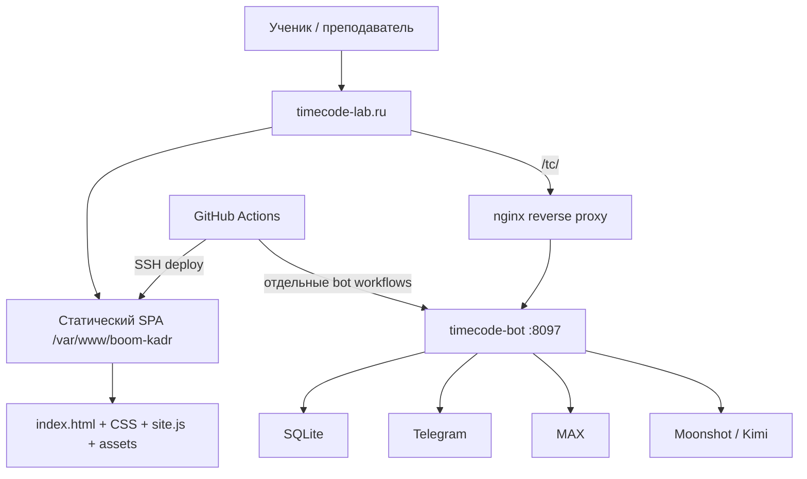

# TIMECODE — PROJECT AI HANDBOOK

> Эксплуатационный паспорт сайта, контура публикации и связанного TIMECODE-бота.  
> Этот документ нужно прочитать до любых изменений проекта.

| Поле | Значение |
|---|---|
| Проект | TIMECODE — лаборатория креативных медиа |
| Дата аудита | 2026-10-11 09:02 UTC |
| Обследованный checkout | `/workspace/scratch/88cd9ca1586f/timecode-audit` |
| Репозиторий | `https://github.com/mityademon-rgb/news.git` |
| Ветка | `boom-kadr-deploy` |
| Проверенный commit | `1760d97315fd6b7e061dde233a4ab8433b9f1baa` |
| Публичный сайт | `https://timecode-lab.ru/` |
| Production static root | `/var/www/boom-kadr` согласно действующему workflow/nginx-конфигурации |
| Связанный bot root | `/opt/timecode-bot/timecode-bot` |
| Статус | Актуально для указанного commit и фактов production, проверенных 11.10.2026 |

> **Живая память проекта:** текущее устройство хранится в этом handbook, а последовательность всех изменений — в [`PROJECT_CHANGELOG.md`](PROJECT_CHANGELOG.md). Перед работой прочитать оба файла. Корневой `AGENTS.md` делает это обязательным для AI-агентов.

## Статусы достоверности

- **Проверено** — подтверждено исходниками, Git, безопасной локальной проверкой, живым HTTP/UI или успешным read-only production-аудитом.
- **По конфигурации** — следует из файлов репозитория, но сам объект на сервере напрямую не читался в этой сессии.
- **Не проверено** — доступа или безопасного доказательства недостаточно; это нельзя считать фактом.
- **Запрещено в диагностике** — действие меняет production, БД, сервис или отправляет сообщения.

## Оглавление

1. [Краткая карта системы](#1-краткая-карта-системы)
2. [Что работает сейчас](#2-что-работает-сейчас)
3. [Структура репозитория](#3-структура-репозитория)
4. [Frontend и бизнес-логика](#4-frontend-и-бизнес-логика)
5. [Контент и данные сайта](#5-контент-и-данные-сайта)
6. [Стили, шрифты и ресурсы](#6-стили-шрифты-и-ресурсы)
7. [Сборка и источник истины](#7-сборка-и-источник-истины)
8. [Инфраструктура и публикация](#8-инфраструктура-и-публикация)
9. [Связанный бот и Mini App](#9-связанный-бот-и-mini-app)
10. [Git и процесс разработки](#10-git-и-процесс-разработки)
11. [Проверки и диагностика](#11-проверки-и-диагностика)
12. [Практические сценарии](#12-практические-сценарии)
13. [Риски и технический долг](#13-риски-и-технический-долг)
14. [Инструкция для резервного AI-агента](#14-инструкция-для-резервного-ai-агента)
15. [Регламент обновления handbook](#15-регламент-обновления-handbook)
16. [Ограничения аудита](#16-ограничения-аудита)

---

## 1. Краткая карта системы

TIMECODE — русскоязычная образовательная лаборатория креативных медиа для двух программ:

- **KIDS LAB, 12+** — камера, интервью, композиция, видеосюжеты и собственный канал;
- **MEDIA LAB, 14+** — сценарий, журналистика, формат программы, репортаж и социальные медиа.

Основные пользовательские сценарии:

1. Открыть интерактивный урок и пройти его по экранным сценам.
2. Включить полноэкранный режим и подсказки преподавателю.
3. Открыть служебный план урока преподавателя.
4. Играть в четыре коротких медиа-игры.
5. Читать киноистории и библиотеку практических лайфхаков.
6. Смотреть материалы проекта «Ты в теме!» и переходить в VK.
7. Пользоваться связанным Telegram/MAX-ботом и Mini App через `/tc/`.



### Компоненты

| Компонент | Назначение | Реальный источник |
|---|---|---|
| Статический сайт | Уроки, игры, кино, лайфхаки, учительский интерфейс | Репозиторий `news`, ветка `boom-kadr-deploy` |
| Nginx | TLS, статика, редиректы, прокси `/tc/` | `.deploy/boom-kadr-https.conf`; живые заголовки сверены |
| GitHub Actions | Публикация сайта и множество операций с ботом | `.github/workflows/` |
| TIMECODE-бот | Telegram/MAX, расписание, игры, рассылки, Mini App | Production `/opt/timecode-bot/timecode-bot`; отдельная кодовая история |
| SQLite | Пользователи, расписание, состояния, очереди, конкурсы | `/var/lib/timecode-bot/timecode.db` |
| Внешние медиа | VK, источники и площадки просмотра фильмов | URL в `app.js`/`site.js` |

Сайт не использует frontend-фреймворк, Node-сборщик, серверный рендеринг или собственный API. Это один hash-based SPA на HTML, CSS и vanilla JavaScript. Backend существует только в отдельном контуре `/tc/`.

---

## 2. Что работает сейчас

### Проверено на живом сайте 11.10.2026

- `https://timecode-lab.ru/` возвращает HTTP 200.
- `https://timecode-lab.ru/tc/health` возвращает HTTP 200 и JSON health-ответ.
- Live-файлы `index.html`, `styles.css`, `lesson03-kids.css`, `site.js` побайтно совпали с проверенным checkout по SHA-256.
- Визуально загружена актуальная 3D-шапка TIMECODE с камерой и микрофоном.
- Проверены маршруты home, PLAY, игра «Разговори человека», кино, история «Матрица», «Ты в теме!», библиотека лайфхаков, урок `interview`, учительский вход.
- На проверенном desktop viewport горизонтального переполнения на этих маршрутах нет.
- Ошибок приложения в консоли не обнаружено; единственная ошибка относилась к служебному browser extension, а не к сайту.

### Функциональная готовность

| Область | Состояние |
|---|---|
| Уроки | 13 записей: 12 готовы, урок 01 KIDS LAB имеет статус `soon` |
| KIDS LAB | 8 записей, из них 7 готовых |
| MEDIA LAB | 5 готовых уроков A01–A05 |
| Сцены уроков | 311 экранов |
| Планы преподавателя | 12, по одному для каждого готового урока |
| PLAY | 4 сценария: talk, crew, hack, frame |
| Киноистории | 6 фильмов, по 2 в трёх категориях |
| Лайфхаки | 48 карточек из уроков, 5 фильтров |
| «Ты в теме!» | Отдельная страница, ссылка на VK Видео и сообщество |
| Бот `/tc/` | Служба и HTTP health доступны на момент проверки |

### В разработке или не завершено

- KIDS LAB урок 01 `studio-start` — карточка «Скоро», без сцен и плана преподавателя.
- В production-аудите бот-конкурса Kimi было 16 участников, но ещё не было кадров, голосов, шорт-листа и результата на момент снимка.
- Нет автоматизированного полного e2e/regression-набора сайта.
- Нет воспроизводимой команды сборки `site.js`; текущий live bundle содержит ручное отклонение от исходников.

---

## 3. Структура репозитория

После введения проектной памяти в репозитории 181 tracked-файл, около 18 MB. В корне нет `package.json`, lock-файла, `.gitignore` или `CLAUDE.md`; правила для агентов находятся в `AGENTS.md`.

```text
news/                         # корень репозитория
├── AGENTS.md                 # обязательный порядок работы AI-агентов
├── PROJECT_AI_HANDBOOK.md    # актуальная архитектурная карта
├── PROJECT_CHANGELOG.md      # последовательный журнал всех изменений
├── index.html                # единственная HTML-точка входа
├── styles.css                # глобальные стили и 3D hero
├── lesson03-kids.css         # отдельные overrides урока 03
├── lessons.js                # данные уроков и 48 лайфхаков
├── lesson-plans.js           # актуальные планы преподавателя
├── teacher-guides.js         # устаревший дубликат; не подключён
├── app.js                    # читаемый runtime-исходник, но без части 3D-правок
├── site.js                   # фактически загружаемый production bundle
├── README.txt                # устаревшая инструкция
├── assets/                   # изображения, бренд и шрифты
│   ├── brand/                # SVG-логотипы и знаки
│   └── fonts/                # TTF и лицензии
├── .deploy/                  # nginx и исторические shell-deploy scripts
├── scripts/                  # создание записи и локальная проверка памяти
└── .github/workflows/        # 92 workflow, включая documentation guard
```

### Карта значимых файлов

| Путь | Роль | Можно менять | Особое правило |
|---|---|---|---|
| `index.html` | Каркас, header/footer, CSS/JS подключения | Да, с проверкой всех маршрутов | При изменении bundle/CSS обновлять cache-busting query |
| `styles.css` | Основной визуальный слой | Да | 7 186 строк и много исторических media-query; проверять каскад |
| `lesson03-kids.css` | Изолированные стили конкретного урока | Только если затронут этот урок | Не переносить вслепую в общий CSS |
| `lessons.js` | Контент и сцены уроков | Да | После правки нужно синхронизировать `site.js` безопасным способом |
| `lesson-plans.js` | Актуальные учительские планы | Да | Должны соответствовать ready-урокам |
| `teacher-guides.js` | Старый набор планов | Не использовать как source of truth | Не подключён и не публикуется текущим workflow |
| `app.js` | Основная SPA-логика | Да | Сейчас не содержит всех live 3D-изменений |
| `site.js` | Файл, реально выполняемый браузером | Только осознанно | Нельзя слепо пересобирать конкатенацией |
| `assets/` | Изображения, SVG, шрифты | Да | Сверять пути, размер и лицензию |
| `.deploy/boom-kadr-https.conf` | Текущая проектная схема nginx | Только с отдельной инфраструктурной проверкой | Сохранять `/tc/` proxy |
| `.deploy/install.sh`, `update.sh`, `https.sh` | Старый pull-based deploy | Не запускать | Содержат старый IP и неполный набор файлов |
| `.github/workflows/deploy-boom-kadr.yml` | Текущий static deploy | Только после review | Имеет неполные path triggers и неполный rollback |
| `PROJECT_CHANGELOG.md` | Хронология каждого изменения | Обновлять в каждом commit | Не содержит секретов; newest-first после маркера |
| `AGENTS.md` | Обязательные правила следующему AI | Менять вместе с handbook/changelog | Действует на весь репозиторий |
| `scripts/check-project-documentation.sh` | Локальный и CI guard | Да, с self-test | Требует changelog всегда и handbook для structural paths |
| остальные workflows | Bot deploy/диагностика/разовые операции | Не запускать для исследования | Многие рестартуют сервис, пишут БД или шлют сообщения |

### Исходники, сборка и serving directory

- **Исходники в Git:** перечисленные файлы корня.
- **Фактическая browser-сборка:** `site.js`.
- **Serving directory по workflow:** `/var/www/boom-kadr`.
- **Deployment archive:** создаётся в GitHub Actions и распаковывается поверх существующей serving directory.
- Production static root не объявлен Git checkout; workflow копирует архив, поэтому `git status` там не является ожидаемой диагностикой.
- Workflow не очищает удалённые из Git файлы на сервере: stale-файлы могут оставаться.

---

## 4. Frontend и бизнес-логика

### Стек

- HTML5, CSS3, vanilla JavaScript.
- Hash router в `route()` около конца `app.js`/`site.js`.
- Полное client-side rendering через `main.innerHTML`.
- Состояние урока и доступ преподавателя — `localStorage`.
- Fullscreen API с CSS fallback `presentation-mode`.
- Web Audio API создаёт короткий звук кнопки; аудиофайла нет.
- Сетевых `fetch`, XHR, WebSocket или EventSource в сайте нет.

### Маршруты

| Route | Renderer | Назначение |
|---|---|---|
| `#/` | `renderHome()` | Главная, 3D hero, превью разделов |
| `#/lesson/:id` | `renderLesson()` | Урок по сценам |
| `#/teacher` | `renderTeacherPortal()` | Список планов/форма доступа |
| `#/teacher/:id` | `renderTeacherPortal(id)` | Конкретный план |
| `#/play` | `renderPlayHub()` | Хаб игр |
| `#/play/talk` | `renderTalkGame()` | Игра интервью |
| `#/play/crew` | `renderCrewTest()` | Тест роли в производстве |
| `#/play/hack` | `renderDailyHack()` | Лайфхак дня |
| `#/play/frame` | `renderFrameGame()` | Игра на ошибки кадра |
| `#/cinema` | `renderCinemaHub()` | Каталог фильмов |
| `#/cinema/:id` | `renderCinemaStory(id)` | История фильма |
| `#/you-in-topic` | `renderYouInTopic()` | Страница шоу |
| `#/lifehacks` | `renderLifehackLibrary()` | Все лайфхаки и фильтры |
| `#lessons`, `#lifehacks`, `#about` | `renderHome(anchor)` | Legacy-якоря главной |

Неизвестный route возвращает пользователя на главную. Сервер для любого несуществующего пути отдаёт `index.html`, но приложение ожидает именно hash route.

### Важные функции и зависимости

| Что делает | Где | Откуда вызывается | Безопасное изменение и проверка |
|---|---|---|---|
| Маршрутизация | `route()` | `hashchange`, старт IIFE | Добавить route, renderer, nav-link; проверить прямой URL и переходы между разделами |
| Главная/3D hero | `renderHome()`, `bindTitleInteractions()` | `route()` | Сверить `app.js` и `site.js`; pointer, reduced-motion, desktop/mobile |
| Урок | `renderLesson()`, `drawScene()`, `sceneTemplate()` | `#/lesson/:id` | Проверить все типы сцен, стрелки, F, Escape, сохранение прогресса |
| Прогресс | `changeScene()` | Кнопки/клавиши | Ключ `timecode:<lesson-id>:scene`; проверить старый fallback `boom-kadr:*` |
| Teacher mode | `toggleTeacherMode()` | Кнопка урока | Проверить подсказки во всех типах сцен |
| Fullscreen | `toggleFullscreen()` | Кнопка/F | Проверить API и CSS fallback на мобильном браузере |
| Планы | `renderTeacherPortal()` | Teacher routes | План существует только при ready-уроке и записи в `lesson-plans.js` |
| Лайфхаки | `renderLifehackLibrary()` | `#/lifehacks` | Данные берутся из всех `lesson.lifehacks`; проверить фильтры и count |
| Кино | `cinemaCatalog`, renderers | cinema routes | Проверить источник, watch URL, `target=_blank` и `rel=noopener noreferrer` |
| PLAY | каталоги/состояние `state` | play routes | Проверить restart/next/result для каждой игры |

### Состояние и авторизация

- Прогресс урока хранится только в браузере; серверного профиля и синхронизации нет.
- Teacher portal использует client-side hard-coded gate и флаг `timecode:teacher-access=granted`.
- Это **не настоящая авторизация**: проверка и секрет находятся в публичном JS, а флаг можно установить вручную.
- Нельзя хранить в teacher plans персональные, закрытые или чувствительные сведения.
- Фактические значения client-side credential намеренно не повторяются в handbook.

### Обработка ошибок

- Для неизвестного урока/игры/фильма — возврат к соответствующему hub/home.
- Fullscreen имеет try/fallback, но общесайтового error boundary нет.
- Ошибка загрузки `site.js` оставит пустой `<main>`.
- Нет централизованного логирования, telemetry или мониторинга frontend.

### Найденное поведение SPA

При последовательной навигации между разделами классы `cinema-active`, `topic-active`, `home-active`, `lesson-active`, `teacher-portal-active` удаляются несимметрично и могут накапливаться на `<body>`. В проверенном проходе route продолжали отображаться, но это технический долг и риск CSS-конфликтов. Исправление должно сопровождаться матрицей переходов между всеми разделами.

---

## 5. Контент и данные сайта

### Уроки

`lessons.js` экспортирует `window.TIMECODE_LESSONS`. Каждая запись обычно содержит id, номер, track/status, заголовок, summary, color, tags, cover, сцены и lifehacks.

- 13 уроков.
- 12 ready, 1 soon.
- 311 сцен: 12 cover, 2 choice, 1 rule, 1 practice, 12 finish, 283 magic.
- Ready-уроки не имеют пустых сцен; duplicate lesson id не найдено.

Основные типы сцен обрабатывает `sceneTemplate()`. При добавлении нового `scene.type` сначала добавить renderer и teacher note, затем контент.

### Учительские планы

`lesson-plans.js` экспортирует `window.TIMECODE_TEACHER_GUIDES`:

- 12 guide-записей;
- покрытие совпадает со всеми 12 ready-уроками;
- `studio-start` ожидаемо не имеет guide;
- структура: аудитория, длительность, результат, подготовка, блоки, checkpoints, avoid.

`teacher-guides.js` содержит старую сокращённую копию, не подключён `index.html`, не включён в deployment archive и не должен редактироваться вместо `lesson-plans.js`.

### Игры и кино

- `playCatalog`: `talk`, `crew`, `hack`, `frame`.
- Crew profiles: director, operator, journalist, editor, producer.
- Interview rounds: 5; crew questions: 6; daily hacks: 6; frame questions: 4.
- `cinemaCatalog`: `ivan-vasilievich`, `diamond-arm`, `matrix`, `jaws`, `morozko`, `buratino`.
- Категории: «Наши», «Зарубежные», «Сказки» — по два фильма.
- В Matrix watch link используется KION, но в списке редакционных источников всё ещё есть Apple TV. Это не runtime-баг, а редакционное решение для согласования владельцем.

### Лайфхаки

- 48 элементов собираются из `lesson.lifehacks`.
- Фильтры: shooting, directing, script, journalism, on-camera.
- Счётчик и карточки вычисляются динамически; не хранить число 48 отдельно в HTML.

---

## 6. Стили, шрифты и ресурсы

### CSS

- `styles.css`: 7 186 строк; общий дизайн, responsive breakpoints, print и `prefers-reduced-motion`.
- `lesson03-kids.css`: 299 строк; overrides отдельного занятия.
- В stylesheet есть несколько исторических слоёв и повторяющиеся media queries. Изменение позднего блока может перекрыть раннее правило с той же специфичностью.
- Перед правкой искать все определения класса через `rg`, а не менять первое совпадение.

### Шрифты

Фактически объявлены через `@font-face`:

- Rubik Mono;
- Oswald TIMECODE.

В `assets/fonts/` также лежат `Onest-Variable.ttf` и `Pangolin-Regular.ttf`, но для них нет действующего `@font-face`. При этом body ссылается на `Onest BK`, поэтому браузер использует fallback system sans. Это несоответствие следует либо осознанно исправить с проверкой лицензии/метрик/CLS, либо убрать неиспользуемые ресурсы отдельной задачей.

### Assets

- Проверено 59 локальных ссылок на ресурсы: отсутствующих файлов не найдено.
- Основной формат изображений — WebP; бренд — SVG; шрифты — TTF.
- Известные неиспользуемые кандидаты: `adult01-fireworks.webp`, `adult01-rain-cake.webp`, старые `boom-kadr` SVG, Onest и Pangolin.
- Не удалять их в рамках другой задачи: сначала подтвердить отсутствие runtime/CSS/workflow ссылок и согласовать визуальную историю.

---

## 7. Сборка и источник истины

### Критическое расхождение

Исторически `site.js` задуман как:

```text
lessons.js + lesson-plans.js + app.js
```

Но на commit `1760d97` это **не так**. Сравнение показало 20 добавленных и 6 удалённых строк относительно простой конкатенации. Только `site.js` содержит:

- wrapper `.timecode-word-3d` и `data-title="TIME:CODE"`;
- `.studio-depth-lines`;
- обновлённый pointer handler через `requestAnimationFrame`;
- координаты света и reset на `pointerleave`.

`app.js` обновлялся позже по кино-ссылке, а 3D-правки были внесены только в `site.js`. Следовательно:

1. `site.js` — фактический runtime source of truth для поведения live-сайта.
2. `lessons.js` и `lesson-plans.js` — source of truth для данных.
3. `app.js` — основной читаемый исходник логики, но не полная копия runtime.
4. Простая конкатенация сейчас удалит 3D-функциональность.

### Безопасный путь исправления сборки

Отдельной согласованной задачей:

1. Перенести подтверждённые 3D-различия из `site.js` в `app.js`.
2. Сравнить runtime до/после на главной, при pointerleave и reduced-motion.
3. Ввести детерминированный script сборки, например shell/Node, который пишет `site.js` в фиксированном порядке.
4. Добавить CI-check: сгенерированный temp bundle должен побайтно совпадать с tracked `site.js`.
5. Только после этого считать `site.js` генерируемым и запрещать ручное редактирование.

До выполнения этих шагов **не выполнять** `cat lessons.js lesson-plans.js app.js > site.js`.

### Cache busting

`index.html` подключает:

```text
styles.css?v=20261009-industrial-type
lesson03-kids.css?v=20260917-2
site.js?v=20261008-3d1
```

Nginx кэширует CSS/JS/images 7 дней. Любая правка содержимого должна сопровождаться изменением соответствующего `?v=`. Query для `site.js` меняется вручную и не проверяется CI.

---

## 8. Инфраструктура и публикация

### Проверенная схема

- Public domain: `timecode-lab.ru`.
- `www.timecode-lab.ru` и legacy nip.io перенаправляются на canonical host по repository config.
- SSH/deploy endpoint в workflow: `217.149.24.242`.
- HTTPS vhost слушает адрес `217.149.24.234:443`.
- Static root: `/var/www/boom-kadr`.
- `/tc/` proxy: `http://127.0.0.1:8097/` со снятием префикса.
- TLS: Let's Encrypt, протоколы TLS 1.2/1.3 по конфигурации.
- Live server header: nginx 1.28.3 (Ubuntu).
- Security headers: `X-Content-Type-Options: nosniff`, `Referrer-Policy: strict-origin-when-cross-origin`.

Не проверены непосредственно: активный on-host nginx file, certificate expiry/renew timer и системные nginx logs. Конфигурация и живое поведение согласуются, но это не полный root-level audit статического vhost.

### Текущий CI/CD

`.github/workflows/deploy-boom-kadr.yml`:

1. Запускается на push в `boom-kadr-deploy` для ограниченного списка путей или вручную.
2. Checkout фиксированной ветки.
3. Создаёт archive из HTML, CSS, `site.js`, исходных JS, assets и README.
4. Загружает archive и nginx configs по SSH.
5. Распаковывает поверх `/var/www/boom-kadr`.
6. Проверяет nginx config, локальный HTTP, DNS, сертификат и локальный HTTPS.
7. Проверяет public canonical/www/legacy и два соседних сайта.

### Проблемы deployment workflow

- Path trigger не включает `site.js` и `lesson-plans.js`. Commit только этих файлов **не запустит deploy**.
- Path trigger не включает `teacher-guides.js`, а archive тоже не включает его; сейчас это соответствует тому, что файл устарел.
- Archive содержит `app.js`, `lessons.js`, `lesson-plans.js`, хотя браузер их не подключает напрямую.
- Распаковка идёт поверх существующих файлов без очистки removed assets.
- Rollback сохраняет только nginx config. Предыдущая версия статических файлов не архивируется.
- Ошибка после распаковки может оставить новые static bytes при возвращённом старом nginx config.
- `certbot --keep-until-expiring` выполняется в каждом deploy и расширяет blast radius обычной контентной публикации.
- Workflow использует root SSH; компрометация action/secret даёт высокий impact.

### Устаревшие deployment scripts

`.deploy/install.sh`, `.deploy/update.sh`, `.deploy/https.sh` относятся к старой BUM.КАДР-схеме и адресу `72.56.65.161`. `update.sh` копирует неполный набор и не поддерживает nested assets/fonts/brand, `site.js`, планы и дополнительный CSS. Их запуск на текущем production запрещён до отдельной миграции/удаления.

### Безопасная публикация сайта

До изменения:

```bash
git fetch origin boom-kadr-deploy
git status --short --branch
git diff --check
```

Локальные read-only проверки:

```bash
node --check lessons.js
node --check lesson-plans.js
node --check app.js
node --check site.js
rg -n 'styles.css\?v=|lesson03-kids.css\?v=|site.js\?v=' index.html
```

После согласованного commit/push дождаться workflow `Deploy TIMECODE safely`, затем:

```bash
curl -fsS https://timecode-lab.ru/ | rg 'TIMECODE'
curl -fsSI 'https://timecode-lab.ru/site.js?<current-version>'
curl -fsS https://timecode-lab.ru/tc/health
```

Нужно также сравнить SHA-256 live-файлов с commit, открыть основные routes, проверить desktop/mobile, pointer/reduced-motion, урок, teacher, fullscreen и console.

### Откат сайта

Текущий workflow не обеспечивает content rollback. Практический вариант:

1. Определить последний известный хороший commit.
2. Создать новый revert commit только затронутых site-файлов; не force-push.
3. Убедиться, что изменён путь, входящий в deploy trigger; лучше вручную запустить workflow после review.
4. Проверить live SHA и маршруты.
5. Если deploy оборвался после распаковки, нужен явный серверный snapshot/backup static root — текущий workflow его не создаёт.

`git reset --hard`, `git clean`, force-push и ручное удаление `/var/www/boom-kadr` не являются допустимым штатным откатом.

---

## 9. Связанный бот и Mini App

### Граница компонентов

Бот не хранится полноценно в этом checkout. Его production root — `/opt/timecode-bot/timecode-bot`; на сервере уже сохранён отдельный подробный `PROJECT_AI_HANDBOOK.md`. Этот документ не заменяет bot handbook: перед изменением `/tc/` нужно прочитать серверный файл.

### Проверенные production-факты 11.10.2026

- Ubuntu 26.04 LTS, Python 3.14.4.
- `timecode-bot.service` active.
- Working directory `/opt/timecode-bot/timecode-bot`.
- HTTP port 8097, public base URL `https://timecode-lab.ru/tc/`.
- SQLite `/var/lib/timecode-bot/timecode.db`, quick_check OK, размер около 2.64 MB.
- DB/env имеют mode 0600.
- Kimi model `kimi-k2.6`; отдельная vision model не задана.
- Telegram работает через polling; MAX — webhook; scheduler выполняется в том же Python-процессе.
- 17 enabled users: 1 admin, 16 members. В handbook и отчётах нет персональных строк.
- Расписание: вторник kids 18:00, media 19:00; суббота kids 12:00, media 13:30; старый media 15:00 disabled.
- Watchdog/health timers active.
- Диск: около 14 GB, использовано 5.7 GB, свободно 7.7 GB на момент аудита.
- Production bot Git HEAD `799d465512286f1316cc5c0cb2d871badc82a359`.

### Архитектура бота

Один Python-процесс обслуживает:

- Mini App HTTP/API;
- Telegram long polling;
- MAX webhook;
- scheduler;
- контент, конкурсы, игровые состояния;
- очереди уведомлений;
- Kimi/Moonshot AI-интеграцию.

SQLite содержит users, lessons/overrides, sent/outbox, check-ins, игры, Kimi contests/votes/results, screenplay/script reviews, identity mapping и другие operational таблицы. Полная обезличенная schema и fingerprints находятся в bot handbook на production.

### Критическая особенность Git бота

Production bot checkout не чистый:

- `server.py` modified;
- статические файлы modified;
- множество новых модулей/resources untracked;
- состояние не воспроизводится простым checkout известного commit.

Нельзя выполнять в `/opt/timecode-bot/timecode-bot`:

```text
git reset --hard
git clean -fd
git pull с возможным overwrite
замену server.py старой копией целиком
```

Сначала сохранить полный inventory/diff/backup, определить фактический source of truth и оформить server-only работу в Git без потери файлов.

### Безопасная диагностика бота

Только read-only и только при разрешённом production-доступе:

```bash
systemctl is-active timecode-bot.service
systemctl show timecode-bot.service -p MainPID -p ActiveState -p ExecMainStartTimestamp
curl -fsS --max-time 5 http://127.0.0.1:8097/health
curl -fsS --max-time 10 https://timecode-lab.ru/tc/health
systemctl list-timers --all
ss -ltn
cd /opt/timecode-bot/timecode-bot
git status --short --branch
```

Для логов:

```bash
journalctl -u timecode-bot.service --since '30 minutes ago' --no-pager
```

Логи могут содержать персональные данные и сообщения: анализировать на сервере, наружу переносить только агрегаты и обезличенные ошибки.

SQLite читать URI `mode=ro`, не импортировать приложение ради schema: некоторые module `install()` меняют БД уже при импорте. Не запускать retry, scheduler tick или watchdog вручную — они способны отправлять реальные сообщения/менять состояние.

### Изменяющие операции

`systemctl restart timecode-bot.service`, database backup/restore, API schedule edit, delivery retry, запуск bot-deploy/broadcast workflows — только после отдельного согласования, backup и плана проверки. Откат кода не отменяет миграции БД и уже отправленные сообщения.

---

## 10. Git и процесс разработки

### Проверенное состояние аудита

- Remote: `origin https://github.com/mityademon-rgb/news.git`.
- Ветка: `boom-kadr-deploy`.
- Local и remote HEAD до создания handbook совпадали: `1760d973...`.
- Свежий audit checkout был clean.
- Отдельный старый checkout `/workspace/scratch/88cd9ca1586f/timecode-site` находится на `2cb83a7` и имеет пользовательские uncommitted font changes. Его нельзя reset/clean и нельзя считать текущим source of truth.
- Последний commit core-сайта: `d514e7e` — industrial condensed display type.
- Последний commit 3D hero: `5b5f7b8` плюс CSS fixes `132451b`, `1ea115c`.

### Workflow inventory

В `.github/workflows/` — 92 YAML после добавления documentation guard:

- все 92 содержат push trigger;
- 15 дополнительно имеют `workflow_dispatch`;
- 87 содержат SSH-контур;
- 51 содержит restart/start/stop service;
- 12 содержат признаки messaging/broadcast;
- 12 содержат SQL write operations.

Это смесь текущего deploy, диагностики и одноразовых production-патчей. Сам факт наличия workflow не означает, что его безопасно повторить. Некоторые workflow запускаются push-ом собственного файла и способны рестартовать бот/отправить сообщения.

### Правила Git

1. Всегда `fetch` и сверить remote head до создания commit.
2. Работать из clean checkout/ветки; не использовать stale `timecode-site`.
3. Не смешивать content/design, infrastructure и bot changes в одном commit.
4. Не force-push production branch.
5. Перед push просмотреть `git diff --stat`, полный diff и `git diff --check`.
6. Для site changes убедиться, что путь входит в deploy trigger; иначе явно запустить reviewed workflow или исправить trigger отдельным commit.
7. Зафиксировать live commit/hashes и результаты проверки после deploy.
8. Не трактовать успешный Git commit как успешную публикацию.

### Устаревшая документация

`README.txt` говорит о `dist/`, которого нет, и утверждает, что изменения в `lessons.js` достаточно загрузить напрямую. Live page загружает `site.js`, поэтому README неполон и опасен как operational guide. Использовать handbook как стартовую карту, затем проверять затронутые факты.

---

## 11. Проверки и диагностика

### Выполнено в аудите

- `node --check`: `lessons.js`, `lesson-plans.js`, `app.js`, `site.js` — пройдено.
- Проверка duplicate lesson id — дублей нет.
- Проверка ready lessons без scenes — отсутствуют.
- Покрытие guides — 12/12 ready lessons.
- Проверка локальных asset references — 59 ссылок, 0 missing.
- Сравнение expected concatenation с `site.js` — обнаружен 3D drift.
- SHA-256 live/repo для 4 обслуживаемых core-файлов — полное совпадение.
- HTTP root и `/tc/health` — 200.
- UI smoke восьми ключевых routes — отрисовка успешна.
- Desktop horizontal overflow — не обнаружен на проверенных routes.
- Browser console — ошибок сайта не обнаружено.

### Минимальный локальный smoke

```bash
node --check lessons.js
node --check lesson-plans.js
node --check app.js
node --check site.js
git diff --check
```

Запуск локального static server, если разрешён и нужен визуальный review:

```bash
python3 -m http.server 4173 --bind 127.0.0.1
```

Команда только локальная; не запускать её вместо production service и не открывать наружу.

### Матрица ручной проверки сайта

| Область | Проверить |
|---|---|
| Главная | 3D depth, pointerleave, CTA, hero clipping, nav |
| Mobile | 320/375/430 px, menu, отсутствие overflow, readable hero |
| Reduced motion | Нет обязательной анимации/pointer эффекта |
| Урок | Первый/последний кадр, next/back, reload progress, legacy key |
| Fullscreen | Button, F, Escape, mobile CSS fallback |
| Teacher | Login failure/success без публикации credential, logout, print |
| PLAY | Каждый из 4 flows до результата и повторный запуск |
| Cinema | 6 routes, source/watch links, возврат в каталог |
| Lifehacks | 48 cards, каждый filter, reset/count |
| SPA transitions | Все body classes после переходов в обе стороны |
| Console/network | 404 assets, JS errors, cache version |

### Неавтоматизированные проверки

Фактическая responsive-вёрстка на физических iOS/Android, Safari fullscreen, screen-reader workflow, печать teacher plan, доступность keyboard focus по всем играм и внешние ссылки не прошли исчерпывающий тест. Их нельзя объявлять подтверждёнными.

---

## 12. Практические сценарии

### Сценарий: изменить 3D-шапку или дизайн главной

1. Найти все правила hero в `styles.css` и markup/interaction в `app.js` и `site.js`.
2. Из-за текущего drift изменить согласованно runtime `site.js` и source `app.js`; лучше сначала закрыть задачу воспроизводимой сборки.
3. Не менять исходные изображения без проверки размеров/crop на 320–1440 px.
4. Проверить pointer, pointerleave, keyboard CTA, reduced-motion и no-overflow.
5. Обновить CSS/JS cache version в `index.html`.
6. Выполнить syntax/diff/asset checks, затем deploy и live SHA/UI smoke.

### Сценарий: заменить или подключить шрифт

1. Проверить лицензию в `assets/fonts/*-OFL.txt`.
2. Добавить/изменить `@font-face` с уникальным `font-family`, корректными weight/style/display.
3. Использовать этот family в нужных селекторах; не полагаться на отсутствующий `Onest BK`.
4. Проверить кириллицу, латиницу, цифры, line-height, переносы hero/navigation/mobile.
5. Проверить network 200 и отсутствие CLS/FOIT.
6. Обновить CSS cache version и live verify.

### Сценарий: добавить урок

1. Добавить уникальный объект в `lessons.js` с track/status/scenes/lifehacks.
2. Для ready-урока добавить guide в `lesson-plans.js`.
3. Добавить assets и проверить каждую ссылку.
4. Проверить scene types и escape paths; не вставлять непроверенный HTML в контент.
5. Синхронизировать `site.js`, сохранив 3D drift, либо использовать уже исправленный deterministic build.
6. Проверить homepage counts, route, progress, teacher plan, fullscreen, mobile.
7. Обновить query `site.js?v=` и публиковать.

### Сценарий: изменить киноисторию/внешнюю ссылку

1. Править `cinemaCatalog` в `app.js` и runtime `site.js` до устранения drift.
2. Различать editorial source URL и `watchUrl`.
3. Проверить доступность/региональность ссылки и права; не заявлять непроверенные факты.
4. Сохранить `target="_blank" rel="noopener noreferrer"`.
5. Проверить catalog и detail route.

### Сценарий: добавить новый frontend feature

1. Определить route и renderer рядом с существующими функциями.
2. Очистить/установить body classes симметрично.
3. Любые пользовательские строки проводить через `escapeHtml`.
4. Не создавать backend expectation: static site сейчас не имеет API.
5. Если нужны данные пользователя, определить privacy/auth/storage до реализации.
6. Обновить `site.js`, cache version, smoke matrix и handbook.

### Сценарий: сайт недоступен

1. Проверить DNS и `curl -I https://timecode-lab.ru/`.
2. Проверить отдельно asset и `/tc/health`, чтобы разделить static/nginx/bot incident.
3. Проверить последний deploy run и commit.
4. На сервере только с разрешением: `nginx -t`, status nginx, vhost, logs, disk.
5. Не менять DNS/TLS/nginx до определения слоя отказа.
6. Для static mismatch сравнить live SHA с известным commit.
7. Откатить revert commit/verified static backup, а не выполнять broad reset.

### Сценарий: бот недоступен

1. Проверить public и local health, unit state, start timestamp, timers, disk.
2. Green health не доказывает живой polling/scheduler/delivery.
3. Изучить обезличенные journal errors и read-only outbox aggregates.
4. Не импортировать modules и не запускать retry/watchdog ради диагностики.
5. Перед restart сохранить evidence, diff и backup; restart требует согласования.
6. После восстановления проверить Telegram и MAX без массовой отправки/дублей.

### Сценарий: изменить расписание или рассылку бота

Это state-changing работа. Сначала прочитать production bot handbook и затронутые modules, затем проверить lessons/overrides, scheduler, deadlines, watchdog/catch-up и оба транспорта на временной БД. Admin schedule API меняет БД и может разослать уведомления всем; не использовать для проверки.

---

## 13. Риски и технический долг

### Критические

| Риск | Доказательство | Что требуется |
|---|---|---|
| `site.js` невоспроизводим из declared sources | 20 additions/6 deletions, 3D существует только в bundle | Перенести drift в `app.js`, добавить build+CI check |
| Production bot не воспроизводим из Git | Modified/untracked production files, HEAD не описывает полный runtime | Inventory, backup, безопасная нормализация в Git |
| Нет доказанного backup/restore SQLite | Есть ad hoc backup dirs, но нет подтверждённого цикла/off-server restore | Согласовать backup policy и тест восстановления |
| Большой blast radius workflows | 91 push workflow, root SSH, restart/message/DB операции | Архивировать/отключить one-off flows, добавить environments/approvals |

### Высокие

| Риск | Последствие | Рекомендация |
|---|---|---|
| Teacher gate публичный client-side | Любой может получить доступ | Считать материалы публичными или вынести auth на server |
| Deploy triggers пропускают `site.js` и plans | Изменение может не попасть на production | Исправить paths и добавить CI consistency check |
| Нет static content rollback | Failed deploy оставляет mixed/new bytes | Версионированный release dir/symlink или архив всего root |
| Deploy не удаляет stale files | Удалённые assets остаются доступны | Release-dir strategy или manifest-based cleanup |
| Root SSH в Actions | Высокий impact компрометации | Ограниченный deploy user/key/command, GitHub Environment |
| Bot disabled bearer risk | Disabled user может сохранить доступ по ранее выданному bearer | Исправить server-side identity check с тестом |

### Средние

- Body classes накапливаются между SPA routes.
- `styles.css` очень велик и содержит перекрывающиеся исторические слои.
- Нет автоматизированных tests/build/lint/dependency manifest.
- Main content создаётся JS: без JS `<main>` пуст, SEO и resilience ограничены.
- Нет canonical/OG metadata, `robots.txt`, `sitemap.xml`, manifest/service worker.
- Нет CSP, HSTS и frame policy в repository nginx config.
- `README.txt` и старые `.deploy/*.sh` противоречат текущей архитектуре.
- Onest/Pangolin лежат в assets, но не подключены; `Onest BK` падает в fallback.
- 7-day caching зависит от ручного query bump.
- Bot health может быть green при остановленном polling; scheduler использует точную минуту; retries потенциально могут дать дубли.
- Старые bot pending старше yesterday могут не выбираться; import отдельных modules изменяет DB.

### Низкие/редакционные

- Неиспользуемые assets увеличивают репозиторий/архив.
- Осталась Apple TV ссылка среди источников Matrix при заменённом watch link.
- Мёртвые `renderHomeLegacy()` и `bindHomeInteractionsLegacy()` сохраняют старую реализацию.
- Нет `.gitignore`; случайные локальные артефакты легче добавить в commit.

---

## 14. ИНСТРУКЦИЯ ДЛЯ РЕЗЕРВНОГО AI-АГЕНТА

### Перед любой работой

1. Прочитай этот файл полностью.
2. Выполни `git fetch`, проверь ветку, HEAD и clean status.
3. Сверь дату/commit handbook с текущим HEAD и прочитай commits после него только в затронутых путях.
4. Если задача касается `/tc/`, сначала прочитай `/opt/timecode-bot/timecode-bot/PROJECT_AI_HANDBOOK.md` и не считай site repo источником bot runtime.
5. Проверь живые health/hash только read-only средствами.

### Источники истины

- Live static runtime: `index.html`, `styles.css`, `lesson03-kids.css`, `site.js`, `assets/`.
- Lesson content: `lessons.js`.
- Teacher plans: `lesson-plans.js`.
- App source: `app.js`, но обязательно сравнить с `site.js`.
- Nginx intended config: `.deploy/boom-kadr-https.conf`.
- Current static deploy: `.github/workflows/deploy-boom-kadr.yml`.
- Bot runtime: production directory и его handbook, не старые one-off workflows.

### Безопасный старт разработки

```bash
git fetch origin boom-kadr-deploy
git switch boom-kadr-deploy
git status --short --branch
git log -n 10 --oneline
node --check lessons.js
node --check lesson-plans.js
node --check app.js
node --check site.js
```

Не продолжай из dirty/stale checkout, если изменения не твои. Не удаляй их; создай свежий clone/worktree или согласуй владельца.

### Правила изменений

1. Делай минимальный адресный diff.
2. Не переписывай архитектуру в рамках content/design задачи.
3. Не пересобирай `site.js` простой конкатенацией.
4. Не запускай исторические workflows для диагностики.
5. Не запускай server scripts/imports с production DB без понимания side effects.
6. Не публикуй реальные credentials, user rows, tokens, keys, chat content или private logs.
7. Не меняй nginx/DNS/TLS, service, DB или рассылки без отдельного разрешения.
8. Обновляй cache key для изменённого cached asset.
9. Проверяй соседние разделы: SPA/CSS общий.
10. После архитектурного изменения обнови handbook в том же commit.

### Проверка каждого изменения

- Syntax/static checks.
- Diff и asset paths.
- Desktop + mobile + reduced-motion.
- Прямой route и переходы из других разделов.
- Console/network 404.
- Live workflow conclusion и SHA/content после deploy.
- Для bot changes: isolated temp DB, network mocks, unit/regression, local/public health, оба транспорта и no-duplicate evidence.

### Откат

- Site: новый revert commit или verified release backup; не force/reset production.
- Bot code: вернуть только сохранённые изменённые файлы, затем согласованный restart и health/delivery check.
- DB: не заменять старой копией без schema/data compatibility plan.
- Уже отправленные сообщения и внешние side effects откатом кода не отменяются.

### Что обязательно согласовать с владельцем

- Любой production restart/deploy за пределами штатного site workflow.
- DB migration/restore/write query.
- Запуск workflow, который шлёт сообщения или меняет bot state.
- DNS, TLS, nginx, firewall, systemd.
- Массовое удаление assets/workflows/legacy files.
- Изменение расписания, ролей, доступа, конкурса, рассылок и AI personality.
- Действия с пользовательскими данными или внешними аккаунтами.

### Завершение работы

Запиши в commit/handbook:

- дату и SHA;
- что изменено и почему;
- затронутые файлы/зависимости;
- какие проверки выполнены;
- deployed live SHA/status или почему не публиковалось;
- известные ограничения и путь отката.

Не писать «готово» только по факту commit. Для production-готовности нужно живое доказательство.

---

## 15. Регламент обновления handbook

После существенного изменения архитектуры, инфраструктуры, business logic, routes, data model, API, build или deploy работающий агент обязан:

1. Обновить соответствующий раздел этого файла.
2. Обновить дату актуальности и проверенный commit.
3. Перечислить затронутые пути.
4. Зафиксировать новые зависимости и source-of-truth.
5. Обновить команды проверки, deploy и rollback.
6. Добавить/закрыть риски только при наличии доказательств.
7. Сверить документ с живым состоянием затронутого компонента.
8. Не удалять историческое предупреждение, если причина не устранена.

Каждое изменение проекта, включая контент, дизайн, assets, конфигурацию и документацию, дополнительно получает запись в `PROJECT_CHANGELOG.md` в том же commit. Запись содержит цель, файлы, связи, проверки, статус публикации, способ отката и оставшиеся риски. Helper `scripts/new-change-entry.sh` создаёт заготовку, а `scripts/check-project-documentation.sh` и workflow `Require TIMECODE project memory` проверяют соблюдение правила.

CI-проверка не заменяет branch protection: на push она только помечает уже созданный commit как failed. Чтобы нарушение физически не попадало в основную ветку через pull request, GitHub check `documentation-guard` нужно назначить обязательным в правилах ветки.

Мелкие текстовые правки без operational impact не требуют полного переписывания.

### Журнал

- **2026-10-11** — введены `PROJECT_CHANGELOG.md`, обязательный `AGENTS.md`, helper и CI guard: любое изменение фиксируется в журнале; структурное изменение требует также обновить handbook.
- **2026-10-11** — создан полный site/project handbook на commit `1760d973`; проверены repo, bundle drift, content/assets, deploy/nginx configs, workflows, live hashes/routes/health и обезличенные результаты отдельного production bot-аудита. Рабочий код, сервер, БД и сервисы не изменялись.

---

## 16. Ограничения аудита

### Проверено

- Все tracked-файлы текущего site repo по структуре и назначению.
- Core source/data/style files полностью или адресно по функциям и связям.
- Git history затронутых site paths.
- Все workflow по триггерам и признакам side effects; current deploy workflow полностью.
- Repository nginx/deploy configs полностью.
- Live static hashes, HTTP headers, health и ключевые UI routes.
- Обезличенный production bot inventory/schema/aggregates из ранее успешно выполненных owner-approved read-only Actions.

### Не проверено или проверено частично

- Активный server filesystem статического vhost и nginx config непосредственно по SSH в этой сессии.
- Полные nginx/system journal и certificate renewal evidence.
- Восстановление из backup для static root и SQLite — не тестировалось.
- Полная мобильная матрица на реальных устройствах и Safari.
- Screen reader/WCAG audit, print QA и все внешние ссылки.
- Доставка Telegram/MAX end-to-end: audit не отправлял реальные сообщения.
- Полная регрессия bot runtime: существующий набор имеет известные failures/errors и требует изоляции.

### Контрольный вывод

Проект можно передать резервному AI для безопасной работы **при условии**, что он следует источникам истины и ограничениям этого handbook. До воспроизводимой сборки `site.js`, нормализации production bot Git и доказанного backup/restore нельзя считать эксплуатацию полностью воспроизводимой.
